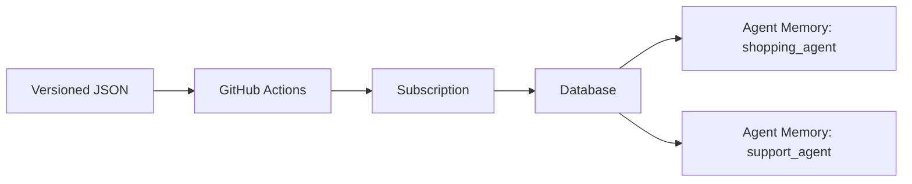

# Demo Guide

Use this guide to present the config-driven Redis Cloud and Agent Memory PoC.
The goal of the demo is to show that infrastructure can be reviewed as a JSON
desired-state file, applied through GitHub Actions, and evolved safely over
time.

The same file can describe multiple services sharing one database. This is the
relationship after adding the second service in the demo:



## October 15 Working Plan

All times refer to America/Sao_Paulo. Let **T** be the presentation start;
the exact start time and duration still need confirmation. The October 14
rehearsal ended with all demo Redis Cloud resources removed. This document
prepares tomorrow's work; it does not start provisioning or schedule a job.

| Window | Work | Exit condition |
| --- | --- | --- |
| Early morning | Select the production candidate commit, review its changes, and run the additional provider tests below. | Every result has a commit, command/case, outcome, and evidence; failures are entered in the backlog. |
| Morning, after mock tests | Exercise recovery, import, drift, and upgrade on disposable infrastructure. Repeat supported lifecycle operations for any provider change. | Resources have a single state owner; failures leave a documented recovery path and no unexplained orphans. |
| By T minus 3 hours | End destructive experiments, classify unresolved findings, fix the presentation provider commit, and start provisioning. | Presentation commit selected; no critical finding affecting the demonstrated flows remains unresolved. |
| By T minus 2 hours | Finish provisioning the presentation subscription, database, and one Agent Memory; rehearse adding, updating, and deleting the second agent. | API confirms active subscription/database and READY store; baseline IDs recorded and remaining plan has no changes. |
| By T minus 90 minutes | Restore the one-agent baseline and freeze presentation configuration/provider changes. | Subscription, database, and shopping-agent IDs preserved; second agent explicitly destroyed and then removed from JSON. |
| T minus 30 minutes | Check API status, unchanged plan, branch/SHA, approvals, and recorded fallback runs. | No pending destructive runs, no planned replacements, and the correct JSON revision is available in GitHub. |
| T minus 15 minutes | Open the config, Actions, Redis Cloud, and selected rehearsal results. | Presentation can proceed without displaying credentials or Terraform state. |

The advance provisioning window includes approval, builds, cloud delays, and
recovery time; the observed approximately 18-minute creation is a measurement,
not a deadline guarantee. If the meeting is earlier than these buffers allow,
prioritize provisioning and stop expanding the morning test scope.

Use separate names and `subscription_key` values for production-readiness
experiments and the presentation. A proposed scratch namespace is
`provider-readiness-20261015`; validate its configuration and networking before
creating it. Never run failure injection, state-transfer experiments, provider
upgrade trials, or full cleanup against the presentation namespace.

Alan continues to approve each apply/destroy in the GitHub `dev` environment.
Do not approve on his behalf or bypass that gate for disposable resources.
Provision the presentation resources on October 15 and keep them available
through the meeting; the October 14 cleanup instruction is not a request to
destroy tomorrow's presentation environment before the presentation.

### Candidate and evidence

- Known rehearsal provider: `a0c7d29254b6f2f115bbe1e454d2926fbe5a678e`.
- Local provider checkout observed on October 14:
  `1c0b452695ea5dbfa3c8eaccb3d2ad3dfd60e0d9`. Its Agent Memory lifecycle has
  not been established by the real runs recorded here. Select and review the
  actual candidate tomorrow rather than assuming the local or remote branch
  head is approved.
- Preliminary comparison between those exact SHAs found no changes under
  `provider/agentmemory`; `go.mod`/`go.sum` differ, including toolchain
  `go1.26.6` to `go1.26.9` and indirect dependencies. The Redis Cloud SDK
  requirement remains `v0.52.2-0.20261009181513-7ae7bef7c657` in that comparison.
  This narrow source comparison does not replace candidate execution or a
  review of the complete provider/dependency delta.
- Delivery branch: `feature/agent-memory-config-driven` while PR #2 is open.
- Presentation config:
  `configs/fetch-rewards/subscriptions/demo-lifecycle-us-east-1.json`.
- Keep provider source `branch` and explicitly enter the selected immutable
  provider SHA for plan, apply, and destroy; do not rely on a moving default.
- For each test record: case ID, provider and SDK commits/versions, Terraform
  and Go versions, provider binary SHA-256, config commit, state prefix,
  timestamps, expected/actual result, public resource IDs, and Actions URL or
  sanitized local log. Never attach raw state, plans, generated credentials,
  authorization headers, or secret-bearing tfvars to the report.

### Additional provider tests

These are **planned**, not passed. P0 items are required before a production
recommendation for the tested scope. P1 items extend that assessment; an
unexecuted case remains an explicit limitation. Morning time limits must not
turn an unexecuted case into a pass or imply that production is approved.

| ID | Priority / execution | Case and acceptance criteria |
| --- | --- | --- |
| Q01 | P0 / local | Pin and review the candidate delta from the rehearsed SHA. Run the Agent Memory package suite, race detector, vet, and the repository-required provider checks. Reproduce the October 14 passing baseline; report any new failure separately from tool/environment failures. |
| Q02 | P0 / mock API | Successful create followed by transient 404, 500, connection loss, or malformed read response. A returned resource ID must remain recoverable in state; the next refresh/apply must converge without an unexplained duplicate. Verify the warning path as well as decoding/validation errors. |
| Q03 | P0 / mock API | Lost create response, failed asynchronous task, 429/503, deadline exceeded, and cancellation. Trace provider and SDK behavior; ensure bounded termination, useful diagnostics, and no blind retry of a non-idempotent create. If an ID cannot be recovered, require an explicit reconciliation procedure. |
| Q04 | P0 / mock API, then scratch | API-key failure after store creation; key/store deleted outside Terraform; parent store missing during key deletion. Reapply and destroy must converge or return a documented actionable error without stranding ownership. Confirm SDK error types before changing error handling. |
| Q05 | P0 / mock API, then scratch | Update accepted by API but follow-up read fails. Refresh and retry must recover actual TTL, cadence, and type/strategy state without losing IDs, rotating unrelated keys, or duplicating custom types. |
| Q06 | P0 / local + scratch | Use fake secret sentinels in API errors and diagnostics to check redaction; verify sensitive schema fields, normal output/log handling, state access, and credential scope. Review SDK error formatting too. Real secrets must never be echoed to perform this check. |
| Q07 | P0 / scratch | Run the supported lifecycle on the candidate: create, add second store, update settings/types, unchanged reapply, selective delete/recreate, and cleanup. Verify API values, key IDs, state ownership, and preservation of external dependencies. Reuse today's successful scenario definitions. |
| Q08 | P1 / scratch | Real import of a store and key metadata into a designated state, plus drift reconciliation. Plan an explicit ownership transfer with encrypted backup if Terraform already owns the object; never leave two active states managing it. A key import cannot recover its secret and must not silently rotate it. |
| Q09 | P1 / scratch | Use state written by the rehearsed provider with the candidate, then check refresh/plan/update. No unexplained replacements, secret loss, or schema errors. Evaluate rollback separately; do not assume state written by a newer provider is safe for an older binary. |
| Q10 | P1 / mock API + scratch | Unsupported type removal/redefinition, model changes, invalid TTL/cadence, and database changes must produce the intended error or explicit replacement plan. The automation must block destructive Agent Memory replacement before applying its phase. |
| Q11 | P1 / scratch | Rotate only a disposable runtime key; verify the old key is revoked, the new key works, and other agents/keys retain IDs. Confirm the delivery procedure for the replacement secret before enabling rotation for customers. |
| Q12 | P1 / separate service smoke | If time permits, use a disposable store/key for one synthetic data-plane write/read and a cross-store authorization check. Keep this separate from Terraform-provider acceptance and from a full load/isolation assessment of the Agent Memory service. |

Starting local commands, executed tomorrow from an isolated checkout of the
selected provider commit with mock credentials and the intended Terraform
binary available to the test helper:

```bash
git rev-parse HEAD
go version
terraform version
go test -count=1 ./provider/agentmemory
go test -race -count=1 ./provider/agentmemory
go vet ./provider/agentmemory
```

Review the provider repository's own contribution/CI instructions before
expanding package selection: broad acceptance-test commands may require real
account credentials. Do not infer that the 39 package tests plus 2 subtests
already passed on an untested candidate. Any production verdict must list the
exact tested scope and remaining gaps; it is not a claim of 100% safety.

### Findings and improvement backlog

Provider source paths below refer to `RedisLabs/terraform-provider-rediscloud`
at the rehearsed commit. This is a preparation log, not a completed audit.
When a case reproduces a defect, add reproduction, expected/actual behavior,
severity, proposed fix, regression test, fixing commit, and retest evidence.

| ID | Owner / priority | Status and next action |
| --- | --- | --- |
| B01 | Provider / P0 | **Risk to reproduce:** in `provider/agentmemory/resource_agent_memory_crud.go`, create saves state after reading/decoding the created object; a decoding diagnostic returns before `State.Set`. Test successful create plus invalid `databaseId` in the read response (Q02). Do not label this a confirmed orphan defect without reproduction. |
| B02 | Provider + SDK / P0 | **Risk to reproduce:** create/key-create response loss and asynchronous errors may leave an object whose ID was not returned. Trace SDK task polling and idempotency before adding retries (Q03/Q04); document reconciliation for an ambiguous result. |
| B03 | Provider + SDK / P0 | **Handling difference to investigate:** API-key Read handles both missing key and missing store; Delete explicitly handles only missing key in `resource_agent_memory_api_key_crud.go`. Test how the SDK maps a missing parent before proposing a fix (Q04). |
| B04 | Provider + SDK / P0 | **Review pending:** CRUD diagnostics include `err.Error()`. Test fake-secret-bearing errors and inspect SDK/log redaction (Q06). The key schema already marks `api_key` sensitive; that alone does not prove every error/log path is redacted. |
| B05 | Workflow / P1 | **Observed, cause unresolved:** run 38631611397 was cancelled overall despite successful jobs and three completed applies. Inspect cancellation events and the apply job's `always()` condition in `.github/workflows/rediscloud-config.yml`. Reproduce safely before changing semantics; this is not a confirmed provider failure. |
| B06 | Workflow/integration / P1 | **Confirmed unfinished integration:** generated runtime keys are not automatically published to `secret_ref`. Define creation/import/rotation delivery and secret-manager access, then implement and test it if required for the customer handoff. This is not a provider CRUD defect. |
| B07 | Provider documentation / P1 | **Confirmed constraint:** custom memory type definitions cannot be removed/redefined in the rehearsed version. Additions and extraction strategy edits work. Document supported edits and an explicit migration path; do not promise an unsupported in-place schema change. |
| B08 | Provider release process / P1 | **Pending evidence:** compare the selected candidate with the tested SHA, record build provenance/checksum, dependency review results, and state compatibility (Q01/Q09). A newer branch head does not inherit the old commit's test results. |

No provider source modification or defect reproduction is claimed by this
planning update. Changes belong in the provider repository with focused
regression coverage and a recorded retest against the resulting commit.

## Presentation Run Sheet — October 15

The full live sequence needs roughly 25–30 minutes with infrastructure already
prepared. For a 15-minute slot, use the existing timing outline and recorded
creation/maintenance runs rather than promising every live apply will finish
inside that window. Adjust once the meeting duration is confirmed.

| Step | Show and say | Evidence / guardrail |
| --- | --- | --- |
| 1. Configuration and ownership | “This file describes the subscription, databases, and agents. Terraform code is reused; your team maintains these values.” Show managed/external modes and stable map keys. | Open the committed lifecycle JSON and diagram. Keep state keys unchanged throughout. |
| 2. Pipeline and creation | Show plan/apply inputs, the fixed provider SHA, approval, dependency phases, and the recorded fresh creation. Explain why the presentation subscription was prepared earlier. | Use green run 38617459129; do not use the cancelled repeat run as green pipeline evidence. A fresh plan previews the subscription and skips missing downstream dependencies. |
| 3. Prepared baseline | Show the active subscription/database and one READY shopping agent, then its unchanged plan. | Compare the IDs recorded that morning. No secret outputs are needed. |
| 4. Include a second agent | Add the documented `support_agent` entry, validate, commit/push to the presentation branch, plan and apply after approval. | Only support-agent resources should be added; existing IDs stay unchanged. Keep run 38621047847 available as fallback. |
| 5. Update through JSON | Change dataset alert 80→75, shopping TTL 86400→172800, cadence 300→120; optionally show the tested type addition/prompt edit. | Review plans for updates without deletion, apply, and verify API values/IDs. Use 38625993962 if a live run is slow. |
| 6. Show convergence | Reapply unchanged or show the unchanged plan and recorded reapply. | Expect no changes; 38626608300 is the recorded four-stack example. |
| 7. Delete just one agent | Destroy with `agent_memory_key=support_agent`, approve, verify disappearance, then remove that entry from JSON and commit. | Shopping agent, database, and subscription remain. Leaving the entry would recreate the deleted agent. Use 38628269393 as fallback. |
| 8. Close with operations | Show the successful full-cleanup record and explain the supported provider scope and secret handoff limitation. | Do not destroy the prepared subscription during the talk unless that exact cleanup is intentional. Show 38630760596 or 38634207011. |

If a live run stalls, show its actual status and switch to the matching
recorded successful run; do not launch duplicate applies. If a new candidate
fails, use the rehearsed commit only after checking that the finding does not
also affect it. A critical issue affecting the demonstration calls for recorded
evidence and a clear limitation, not an unvalidated live workaround.

## Demo Story

1. Show the config file.
   - Open `configs/fetch-rewards/subscriptions/demo-lifecycle-us-east-1.json`.
   - Start with one Agent Memory service, then add the second service using
     the example below.
   - Point out that one subscription can contain one or more databases and one
     or more Agent Memory services.
   - Show that multiple Agent Memory services can reference the same database
     with the stable database key.

2. Explain resource ownership.
   - `mode = "managed"` means Terraform creates and updates the resource.
   - `mode = "external"` means the resource already exists and is referenced by
     ID or name.
   - Stable map keys such as `shared_agent_memory` and `shopping_agent` drive
     state paths and should be treated as durable IDs.

3. Show secret handling.
   - Redis Cloud account API keys are GitHub secrets.
   - The default demo uses platform-managed Agent Memory models. If a config
     uses customer-managed LLM and embedding models, their credentials are
     referenced by env var name, for example `AGENT_MEMORY_LLM_API_KEY`.
   - Agent Memory data-plane API keys are different from Redis Cloud account
     API keys. Terraform marks them sensitive and does not print them.

4. Run `plan`.
   - Use **Actions > Redis Cloud Config Apply > Run workflow**.
   - Select the branch containing the config and workflow changes. While PR #2
     is open, select `feature/agent-memory-config-driven`.
   - Set `config_path` to the demo config or to the customer-specific config.
   - Set `operation = plan`.
   - Set `rediscloud_provider_source = branch` and use the rehearsed provider
     commit `a0c7d29254b6f2f115bbe1e454d2926fbe5a678e` as
     `rediscloud_provider_ref`, including for apply and destroy.
   - Review the GitHub Actions summary before apply.
   - A fresh creation plan skips stacks whose dependencies are being created,
     replaced, or renamed. Once the dependencies exist, plan includes the
     database and Agent Memory stacks even when their mode remains `managed`.

5. Run `apply`.
   - Set `operation = apply` only after the plan summary looks correct.
   - Approve the `dev` environment checkpoint.
   - This checkpoint approves execution before the workflow creates its plans.
   - The workflow applies by dependency phase: subscription, databases, then
     Agent Memory.
   - Each phase is planned before any saved plan in that phase is applied.

6. Show the result.
   - In Redis Cloud, show the subscription, database, and Agent Memory service.
   - In the Actions summary, show the state keys, plan counts, and runtime notes.

7. Show maintenance through the same config.
   - Change a database alert threshold and an Agent Memory policy using the
     example below.
   - Validate the JSON, commit and push it to the demo branch, then run the
     workflow against that branch and the same `config_path`.
   - Compare resource IDs before and after the update. Repeat apply without
     changing the config to check that every stack reports no changes.

8. Delete one service.
   - Run **Redis Cloud Config Destroy** with the same config file,
     `agent_memory_key = support_agent`, and `confirm_destroy = true`.
   - Approve the `dev` checkpoint. Confirm that only the support agent and its
     data-plane keys were destroyed; the shopping agent and backing resources
     keep their IDs.
   - Remove `support_agent` from the JSON after the destroy run succeeds,
     commit it, and run plan again. Keeping the entry would recreate it on apply.

9. Explain complete cleanup.
   - An empty `agent_memory_key` targets all managed resources in the file,
     in reverse dependency order. Use this after the demo for complete cleanup.
   - Re-adding a deleted service to the JSON and applying creates a new store.

## Lifecycle Rehearsal Matrix

Use the isolated `demo-lifecycle-us-east-1.json` config for live tests. Its
subscription is `fetch-demo-lifecycle`, database is `agent-memory-demo-db`,
and every managed state lives under `subscriptions/demo-lifecycle-us-east-1/`.
Use one provider commit throughout the rehearsal and demo.

| Scenario | Expected result |
| --- | --- |
| Fresh plan | Subscription creation is previewed; missing downstream dependencies are reported as skipped. |
| Fresh apply with one service | One subscription, one database with ACL resources, and one Agent Memory service with a runtime key are created. |
| Plan with existing managed dependencies | Subscription, database, and Agent Memory all appear in the plan. |
| Add a second service | Only the new Agent Memory stack is created; existing resource IDs are preserved. |
| Update database alert, memory TTL, and extraction cadence | Relevant resources update in place; IDs are preserved. |
| Reapply unchanged | All stacks report no changes. |
| Delete only the second service | Its store and runtime keys disappear; the first service, database, and subscription remain. |
| Remove the deleted entry and plan | No unintended recreation or changes to remaining resources. |
| Re-add the deleted entry | A new service is created using the same durable state key. |
| Existing subscription, new database and service | The subscription is preserved through apply and cleanup. |
| Existing subscription and database, new service | Only the Agent Memory stack is managed and removed. |
| Full cleanup | Services and keys are destroyed before databases and subscription. |
| Invalid selector or external deletion target | The request fails before approval and destruction. |
| Agent Memory replacement in apply | The guard stops the Agent Memory phase before any of its plans are applied. |

Local regression tests execute the actual workflow shell with a simulated
Terraform CLI to check phase ordering, state selection, and destructive guards:

```bash
python3 -m unittest discover -s tests -v
```

These checks supplement live Actions runs. Record the real run URLs and
resource IDs before marking a lifecycle scenario as passed.

## Add a Second Agent Memory

Add this entry to `agent_memory_stores` beside `shopping_agent` in the same
lifecycle config, validate, commit and push, then run plan and apply:

```json
"support_agent": {
  "mode": "managed",
  "name": "support-agent-demo",
  "database": "shared_agent_memory",
  "short_term_ttl_seconds": 86400,
  "long_term_ttl_seconds": 7776000,
  "extraction_cadence_seconds": 300,
  "summarization": {
    "enabled": true,
    "trigger_strategy": "event_count",
    "event_count": { "threshold": 30, "retain_count": 12 }
  },
  "api_keys": {
    "runtime": {
      "mode": "managed",
      "name": "support-agent-demo-runtime",
      "secret_ref": "aws-secrets-manager:/fetch-rewards/demo/lifecycle/support/runtime"
    }
  }
}
```

Each service has a separate state and keys while sharing the same database.
Use additional stable map keys to add more services with this pattern.

Every custom memory type and each structured field must include a non-empty
`description` of at most 200 characters. The config validator checks this
before Terraform planning. For example:

```json
{
  "name": "shopping_goal",
  "description": "Durable shopping goals",
  "fields": [
    {
      "name": "category",
      "description": "Product category the user plans to shop for",
      "type": "str"
    }
  ],
  "extraction_strategy": {
    "enabled": true,
    "prompt": "Extract lasting shopping goals explicitly stated by the user."
  }
}
```

## Presentation Timing

| Time | Show | Customer takeaway |
| --- | --- | --- |
| 0-3 minutes | JSON, resource references, stable keys, and secrets by reference | Desired infrastructure is versioned in configuration files. |
| 3-6 minutes | Actions inputs, approval, dependency phases, and plan summary | The customer runs the same automation for creation and maintenance. |
| 6-9 minutes | Subscription, database, and Agent Memory in Redis Cloud | The configuration maps to actual resources with separate Terraform states. |
| 9-13 minutes | A reviewed config change and the recorded update run | Routine changes use the same JSON file and workflow. |
| 13-15 minutes | Unchanged reapply, cleanup, and PoC limits | The customer can verify convergence and explicitly control cleanup. |

Rehearse provisioning beforehand and keep the successful run links available.
Use the live run status and recorded results if provisioning takes longer than
the presentation slot. The 15-minute outline uses recorded creation and
maintenance results. Allow extra time if demonstrating every apply, approval,
and selective deletion live. The customer requested cleanup after rehearsal: no subscription should remain
overnight. Start creation on October 15 and allow approximately 18 minutes
based on rehearsal; use the recorded fresh-create run while provisioning is
in progress. After creation, use the one-service baseline for live config
changes.

Measured Terraform apply times from the first rehearsal help choose what to
show live. These exclude provider build, initialization, planning, and approval:

| Operation | Measured apply time |
| --- | --- |
| Fresh subscription | About 8 minutes 49 seconds |
| Fresh database and ACL resources | About 4 minutes 43 seconds |
| First Agent Memory and runtime key | About 10 seconds |
| Add the second Agent Memory and key | About 6 seconds |
| Update database alert | About 44 seconds |
| Update Agent Memory settings | About 2 seconds |

Complete workflow runs take longer. Use the recorded runs for creation if the
presentation slot is short, and demonstrate Agent Memory maintenance live once
the database is ready.

## Configuration Maintenance Example

Use `demo-lifecycle-us-east-1.json` for the one-service baseline, then add the
second service. `demo-ai-us-east-1.json` is the larger two-service reference.
The playground config uses an external `fetch-demo-ai`
subscription, which must already exist.

After the baseline apply, edit these values in the same demo file:

| JSON location | Baseline | Example update |
| --- | --- | --- |
| `databases.shared_agent_memory.alerts` entry named `dataset-size`, field `value` | `80` | `75` |
| `agent_memory_stores.shopping_agent.short_term_ttl_seconds` | `86400` | `172800` |
| `agent_memory_stores.shopping_agent.extraction_cadence_seconds` | `300` | `120` |

These are candidates for updates in place. Confirm the actual plans during the
rehearsal: the database and shopping-agent plans should contain updates, with
no deletes or replacements; the subscription and support-agent plans should
contain no changes. Check that the database ID and Agent Memory store IDs are
preserved, then repeat apply unchanged to verify convergence.

Keep `subscription_key`, `shared_agent_memory`, and `shopping_agent` unchanged.
They identify state and references. Changing a config filename alone does not
create a new state namespace, but changing `subscription_key` does. Existing
resources require import before a new state can manage them.

GitHub Actions reads committed files from the selected branch. Local JSON
edits and the local `.env` do not update the files or secrets used by Actions.
The customer maintenance flow is: edit JSON, validate, review the diff, commit
and push, then run the workflow against that revision.

Keep resource ownership as `managed` during maintenance. Plan can preview
updates once the existing dependency names are available. In apply mode, the
workflow produces and applies saved plans per phase. It does not pause for
another approval after those plans are created.

## Pre-Demo Checklist

- Remote Terraform state is bootstrapped with `stacks/state-backend`.
- GitHub variables are configured:
  - `TF_STATE_BUCKET`
  - `TF_STATE_REGION`
  - `AWS_GITHUB_ACTIONS_ROLE_ARN`
- Redis Cloud secrets are configured:
  - `REDISCLOUD_ACCESS_KEY`
  - `REDISCLOUD_SECRET_KEY`
- Leave `REDISCLOUD_URL` unset for the public Redis Cloud API. Set it only
  when intentionally targeting a non-public Redis Cloud API endpoint.
- If using customer-managed models, configure:
  - `AGENT_MEMORY_LLM_API_KEY`
  - `AGENT_MEMORY_EMBEDDING_API_KEY`
- Until the official Terraform provider includes Agent Memory resources, keep
  the config workflow provider source set to `branch`. The workflow builds the
  Agent Memory provider branch before running Terraform.
- Record the exact provider commit used for the rehearsal. The
  `rediscloud_provider_ref` input accepts a commit SHA; reuse it for the demo
  and cleanup so a moving branch does not change the provider between runs.
- Rehearse from an empty demo state: create the subscription, database, and
  Agent Memory services, apply the maintenance example, and reapply unchanged.
  Record the run URLs, resource IDs, timings, and any unexpected changes.
- Clean up all rehearsal resources on October 14, as requested. Create the
  subscription on October 15; allow approximately 18 minutes for provisioning
  and keep the recorded successful runs available during the wait. The destroy
  workflow removes all managed resources in the selected config, including the
  subscription when its mode is `managed`.
- Confirm the database `source_ips` against the current Agent Memory endpoint
  egress IPs during rehearsal. The checked-in demo list reflects the previous
  test environment and should be reviewed for the selected target.

## Local Dry Run

Validate all config files:

```bash
for config in configs/fetch-rewards/subscriptions/*.json; do
  python3 scripts/rediscloud_config.py validate --config "$config"
done
```

Render the demo config:

```bash
python3 scripts/rediscloud_config.py render \
  --config configs/fetch-rewards/subscriptions/demo-ai-us-east-1.json \
  --out-dir .generated/rediscloud/demo-ai-us-east-1
```

Render configs that use customer-managed models only when the model-provider
secrets are available:

```bash
export AGENT_MEMORY_LLM_API_KEY="<model-provider-api-key>"
export AGENT_MEMORY_EMBEDDING_API_KEY="<embedding-provider-api-key>"

python3 scripts/rediscloud_config.py render \
  --config configs/fetch-rewards/subscriptions/<config-with-customer-managed-models>.json \
  --out-dir .generated/rediscloud/customer-managed-models
```

The generated files under `.generated/` are runtime artifacts and should not be
committed.

## Safe Demo Defaults

- Start with `operation = plan`.
- Use `external` mode for customer resources that already exist and should not
  be managed by this PoC.
- Do not remove a resource from JSON expecting Terraform to destroy it. The PoC
  intentionally avoids implicit deletes from config removal.
- Use **Redis Cloud Config Destroy** with the same `config_path` and
  `confirm_destroy = true` for intentional cleanup.

## Current PoC Limits

- A fresh plan skips stacks whose dependencies are being created, replaced,
  or renamed. Existing managed dependencies support downstream plan previews.
- The config-driven apply workflow creates and updates resources. The separate
  config-driven destroy workflow cleans up managed resources from the same JSON
  file after explicit confirmation and environment approval.
- In the rehearsed provider version, existing custom memory type descriptions
  and field definitions cannot be redefined or removed. Adding a new type and
  changing an existing type's extraction prompt/enabled settings are supported.
  The provider rejects unsupported type edits during planning.
- Lifecycle rehearsal verifies the listed control-plane operations. It does
  not establish production security approval, failure recovery, version upgrade
  compatibility, or data-plane load and isolation behavior.
- Publishing generated Agent Memory data-plane API keys to the referenced
  `secret_ref` is still a follow-up step.
- While Agent Memory support is not in the official Redis Cloud Terraform
  provider, demos that use Agent Memory should run with
  `rediscloud_provider_source = branch`.
- During the Agent Memory public preview, use an eligible Redis Cloud database
  with public endpoint access and the default user enabled.

## Preparation Evidence — October 14, 2026

The demo is scheduled for October 15. Live lifecycle rehearsal uses the isolated
`demo-lifecycle-us-east-1.json` configuration on
`test/rediscloud-lifecycle-20261014`, with provider commit
`a0c7d29254b6f2f115bbe1e454d2926fbe5a678e`. Apply and destroy runs require
manual approval in the `dev` environment. The feature branch keeps the initial
one-service configuration; rehearsal changes are isolated on the test branch.

### Current lifecycle results

| Scenario | Evidence | Result |
| --- | --- | --- |
| Fresh plan | [38617126941](https://github.com/alan-teodoro/fetch-rewards/actions/runs/38617126941) | Subscription creation previewed; downstream dependencies skipped. |
| Fresh creation with one service | [38617459129](https://github.com/alan-teodoro/fetch-rewards/actions/runs/38617459129) | Subscription, database, ACL resources, Agent Memory, and runtime key created. Provisioning took approximately 18 minutes; prepare resources before the presentation. |
| Plan existing managed resources | [38620456809](https://github.com/alan-teodoro/fetch-rewards/actions/runs/38620456809) | All three stacks planned with no changes. |
| Add second service | [38621047847](https://github.com/alan-teodoro/fetch-rewards/actions/runs/38621047847) | Only support-agent resources created; existing IDs and runtime key IDs preserved. |
| Preview maintenance | [38623929266](https://github.com/alan-teodoro/fetch-rewards/actions/runs/38623929266) | Two in-place updates, no creation or deletion. |
| Apply maintenance | [38625993962](https://github.com/alan-teodoro/fetch-rewards/actions/runs/38625993962) | Database alert and shopping-agent settings updated; subscription and both service IDs preserved. API verification confirmed alert 75, TTL 172800, cadence 120, new shopping_goal type, and changed preference extraction prompt. |
| Reapply unchanged | [38626608300](https://github.com/alan-teodoro/fetch-rewards/actions/runs/38626608300) | Four stacks reported no changes, with all IDs preserved. |
| Existing subscription, new database and service | [38627130829](https://github.com/alan-teodoro/fetch-rewards/actions/runs/38627130829) | Only the extra database and service were created. API comparison confirmed original resources and settings unchanged. |
| Block Agent Memory replacement | [38628235213](https://github.com/alan-teodoro/fetch-rewards/actions/runs/38628235213) | Expected failure in plan-only mode: replacement detected and rejected by the guard; no apply executed. The simulated apply regression separately verifies that no Agent Memory plan is applied in this case. |
| Selective service deletion | [38628269393](https://github.com/alan-teodoro/fetch-rewards/actions/runs/38628269393) | Four support-agent resources destroyed. API reads confirmed the service absent and all other resources and settings unchanged. |
| Plan after deleting entry | [38628992929](https://github.com/alan-teodoro/fetch-rewards/actions/runs/38628992929) | Three stacks reported no changes; the deleted service was not recreated. |
| Re-add deleted service | [38629040005](https://github.com/alan-teodoro/fetch-rewards/actions/runs/38629040005) | Four support-agent resources created under the same state key, with new service/key IDs. All other resources preserved. |
| Reject invalid/external destroy selectors | [unknown key](https://github.com/alan-teodoro/fetch-rewards/actions/runs/38629245848), [external resource](https://github.com/alan-teodoro/fetch-rewards/actions/runs/38629405229) | Both failed in validate_request with the expected config errors; approval and destruction jobs were skipped. |
| Existing database by name and ID | [38629438974](https://github.com/alan-teodoro/fetch-rewards/actions/runs/38629438974) | Both services became READY in the same existing database. Only their Agent Memory states were created; all original resources were preserved. |
| Cleanup with external database | [38629671278](https://github.com/alan-teodoro/fetch-rewards/actions/runs/38629671278) | Only the two added service/key states were destroyed. API snapshot exactly matched the state before their creation; both databases and subscription preserved. |
| Cleanup with external subscription | [38630078085](https://github.com/alan-teodoro/fetch-rewards/actions/runs/38630078085) | Extra service and database states destroyed; API reads confirmed the subscription, original database, and two original service states preserved. |
| Full cleanup | [38630760596](https://github.com/alan-teodoro/fetch-rewards/actions/runs/38630760596) | Sixteen resources destroyed in order: shopping service, support service, database, subscription. API confirmed all demo stores, databases, and subscription absent. |
| Repeated fresh creation | [38631611397](https://github.com/alan-teodoro/fetch-rewards/actions/runs/38631611397) | All 12 resources applied and API verified an active subscription/database and one READY store with runtime key. Overall workflow conclusion was cancelled despite successful jobs; this is not a green workflow result. |
| Final cleanup requested by customer | [38634207011](https://github.com/alan-teodoro/fetch-rewards/actions/runs/38634207011) | Succeeded: 12 resources destroyed, Agent Memory before database before subscription. Final API snapshot confirms no demo subscription, databases, or stores remain. |
| Validation CI | [38623603913](https://github.com/alan-teodoro/fetch-rewards/actions/runs/38623603913) | Four Terraform stacks and 14 regression tests passed. |

The Agent Memory package from the exact rehearsed provider commit also passed
39 tests and 2 subtests with a simulated API, with no failures or skipped tests
(`go test -json -count=1 ./provider/agentmemory`). This is separate from the 14
automation regression tests and the live cloud runs. It adds functional
coverage, including mocked import and missing-resource handling, but does not
establish production security approval. Real failure recovery, import/drift,
version upgrades, and security review remain outside today's completed scope.

The first maintenance plan,
[38622467198](https://github.com/alan-teodoro/fetch-rewards/actions/runs/38622467198),
failed before apply because the new `category` field lacked its required
`description`. The example was corrected and config validation now rejects
missing, empty, or overlong descriptions before Terraform runs. Development
override warnings are expected when using the unreleased provider binary.

The original lifecycle matrix has live evidence above, supplemented by local
workflow simulations. Replacement was rejected in a real plan-only run; the
local apply simulation verifies that no Agent Memory plan is applied when any
service in its phase requires deletion or replacement. The repeated one-service creation was confirmed via API and its final cleanup
succeeded. The final API check confirms no demo subscription, databases, or
Agent Memory stores remain. This is the requested overnight state; create the
subscription again on October 15. Additional production-readiness evaluation
is deferred to October 15. The readiness
assessment must identify the exact release-candidate commit: the evidence
here applies to the pinned provider commit, not automatically to later branch
versions.

### Earlier baseline evidence

- [Baseline Terraform validation, October 9](https://github.com/alan-teodoro/fetch-rewards/actions/runs/37981190429)
  passed on commit `9c44806457974a977f4b3ba90a66ca278d4d9ada`.
- [Fresh demo plan, October 14](https://github.com/alan-teodoro/fetch-rewards/actions/runs/38614196232)
  passed against the same repository commit and provider commit
  `a0c7d29254b6f2f115bbe1e454d2926fbe5a678e`. Redis Cloud authentication,
  AWS OIDC, and state-prefix access succeeded. The subscription stack planned
  two creations: the subscription and its Terraform validation resource, with
  no updates or deletes. Database and Agent Memory plans were skipped because
  their dependencies are managed. This run did not create infrastructure.
  It predates the dependency-aware plan correction and selective destroy input.
- [Successful demo apply, October 9](https://github.com/alan-teodoro/fetch-rewards/actions/runs/37977388805)
  used `demo-ai-us-east-1.json` and provider commit
  `a0c7d29254b6f2f115bbe1e454d2926fbe5a678e`. It reused the subscription,
  updated the database, and created the two Agent Memory services. It was not
  a complete fresh-create test.
- [Successful cleanup, October 9](https://github.com/alan-teodoro/fetch-rewards/actions/runs/37980375505)
  destroyed both Agent Memory stacks, the database stack, and the subscription
  stack using the same config and provider commit.
- Local Terraform formatting and all four stack validations passed on
  October 14. Agent Memory validation used a freshly compiled local provider
  from commit `1c0b452`, with the expected development-override warning.
- All five pre-existing configs passed validation and rendering. Rendering used
  dummy model credentials, verified isolated state keys and secret-free
  manifests, and enabled the default user for compatible managed databases.
- Negative config checks rejected a disabled default user, an unknown database
  reference, missing public endpoint access, a literal secret, an unsupported
  alert, and an invalid state key.
- The required backend variable names, Redis Cloud secret names, and the
  `dev` environment reviewer checkpoint were present in GitHub. Local Redis
  Cloud public and QA credentials returned HTTP 200 on read-only subscription
  queries; neither target returned subscriptions at preparation time.
