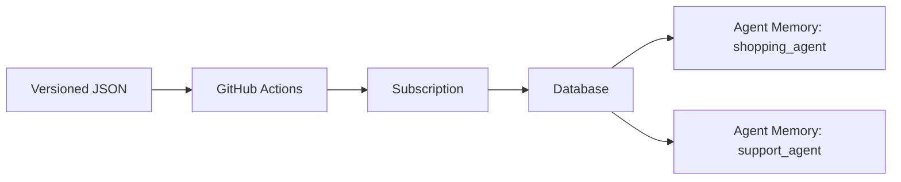

# Internal validation history

Historical execution evidence, including earlier configurations and superseded instructions.
Use [the current demo guide](../demo-guide.md) for the presentation.

# Demo Guide

## Current priority: provider production readiness — October 15

Alan paused presentation work to focus on the provider. The demo remains
removed. The historical lifecycle evidence below uses `c87f535`; the current
production candidate is **`39d6752e915a71c7b58f7ee4b0f63304be3528df`**, published
only on `fix/agent-memory-create-read-recovery`. No merge or release has occurred.
The eight commits are reviewable in draft [provider PR #1031](https://github.com/RedisLabs/terraform-provider-rediscloud/pull/1031),
targeting `alan/agent-memory-terraform-provider`, rather than the release branch.
For any new plan/apply/destroy, explicitly select the corrected SHA above until
the fixes are integrated: workflow defaults still name the original feature
branch, which does not yet contain these commits.

### Corrections and evidence in this candidate

- `03cfcaa` fixes B04 for Agent Memory diagnostics and warnings, including
  malformed database IDs. Shared SDK request/response loggers now emit only
  HTTP method/status and static progress messages; bodies, URLs, headers and
  arbitrary task/error descriptions are omitted. Provider credentials are
  sensitive in both mux schemas. This does not audit every legacy resource's
  diagnostic path or certify Terraform's own trace output.
- The previously separate update-read and key-create regression patches are now
  committed tests. Twelve diagnostic scenarios and actual SDK round trips check
  that fictitious credentials never escape while errors remain errors and
  accepted-create read failures remain warnings where intended.
- At the security-fix stage, with **Go 1.26.9**, the full unit suite passed **196 test/check events**,
  with **116 infrastructure acceptance tests skipped**. The scoped race suite
  passed **110 events**, with 81 acceptance skips. Vet, golangci-lint,
  `go mod tidy -diff`, formatting and workflow Actionlint passed.
  Later opt-in acceptance additions are not counted as those unit-test passes;
  the final exact head passed the official full CI and its recovery acceptance.
- Fuzzing the safe diagnostic/log formatter passed **2,119,419 executions in
  30 seconds** on Go 1.26.9. This tests redaction properties, not service load.
- Linux/amd64 govulncheck passed with no affected called symbols or imported
  packages; one module-only advisory remains outside called code. GitHub's
  three default-branch gRPC alerts require versions through 1.83.0; this
  candidate already contains gRPC 1.83.2. No dependency version was upgraded
  during this hardening work; only obsolete go.sum entries were removed.
- `2f123a3` adds an explicitly opted-in real acceptance test for create,
  import, in-place update, externally introduced TTL drift and reconciliation,
  runtime-key replacement, no-op and cleanup. The fixture owns only one unique
  `tfacc-*` store/key on an existing QA database. Import verification uses the
  harness's temporary state; the original test state owns cleanup. Key-secret
  import is intentionally excluded because the API cannot return that secret.
- The Nix shell now selects Go 1.26 to match the module and its analysis tools.
  A manual CI-only option preserves default acceptance behavior and avoids
  creating unrelated cloud accounts for this targeted check. Recovery and
  safe key-cutover procedures were added to the provider resource docs.
- Official [Nix make ci](https://github.com/RedisLabs/terraform-provider-rediscloud/actions/runs/38748561050)
  **passed on exact 4798ac1**, including vulnerability/dependency checks, both
  Go/provider linters, Terraform formatting, documentation, GoReleaser and
  Markdown validation, build, unit tests and provider-schema generation. The
  first CI run caught tfproviderlint's redundant provider-block rule in the new
  acceptance test; `4798ac1` removed the block and the repeated gate passed.
- The protected acceptance workflow also prepares SDK authentication/isolation
  checks using official Python SDK `redis-agent-memory==0.4.1`. It creates three
  transient keys on the two existing QA stores, checks each store's own key,
  cross-store rejection, replacement-key acceptance and revoked-key rejection,
  then removes its fixture keys. It writes no session/long-term memories.
  Local tests cover failure/cleanup and reject HTTP 503 as an authentication
  result; the actual SDK's HTTP 403 exception was verified with mock transport.
  The live result is recorded below. The latest probe regressions also cover
  HTTP status reporting without SDK body disclosure and administrative request
  headers; 38 automation checks pass locally.

### Real results after QA approval

- [QA provision](https://github.com/alan-teodoro/fetch-rewards/actions/runs/38746945197)
  passed with 16 resources. Subscription `3450517`, database `14694196`, and both
  configured stores are active/READY. The presentation environment remains removed.
- [State read compatibility](https://github.com/alan-teodoro/fetch-rewards/actions/runs/38752867041)
  passed: candidate 4798ac1 read all four states created by c87f535 and produced
  four "No changes" results. No apply or state rollback was performed.
- The [first real test](https://github.com/alan-teodoro/fetch-rewards/actions/runs/38752982140)
  stopped at store import because the API's default summarization block is
  intentionally adopted during import but omitted from the original minimal
  create configuration. Commit 54e7054 compares that imported block to the live
  API while retaining strict equality for the remaining attributes. This fixes
  the test expectation and documents import behavior; it changes no CRUD code.
- [Repeated real test](https://github.com/alan-teodoro/fetch-rewards/actions/runs/38754021885):
  **Terraform acceptance passed in 17.90 seconds** on exact 54e7054: create,
  store/key import, in-place update, externally introduced TTL drift and repair,
  key replacement with old-key absence, no-op and complete fixture destruction.
  Public API snapshots confirm both original QA stores/keys remained unchanged.
  Overall workflow failed in the subsequent probe; do not mark the whole run green.
- The probe failed on an administrative GET with HTTP 403, before any data-plane
  authentication result. Adding explicit client/Accept headers made read-only
  preflight pass; that diagnosis explicitly blocked every POST/DELETE. Error
  reporting now exposes only static stage labels and numeric HTTP status.
  The workflow supports an auth-only repeat under its normal manual dev gate.
- The auth-only run then reached the service and exposed a probe request error:
  SDK 0.4.1 requires `include_all=True` when listing sessions without filters.
  The corrected probe has a real-SDK/mock-transport regression checking all eight
  requests, authorization outcomes and fixture cleanup before cloud execution.
- [Real authentication/isolation/revocation](https://github.com/alan-teodoro/fetch-rewards/actions/runs/38756440780)
  **passed**: own-store keys work, cross-store access is denied, a replacement
  key works, the revoked key is rejected, and the unrelated key remains valid.
  All temporary keys were removed. Final API comparison found the original two
  stores and two keys unchanged from the provisioned baseline. No memory records
  were written; memory promotion/content functionality is outside this probe.
- The separate old/new/old state-write test in
  `scripts/provider_state_compatibility.py`. It creates only its own temporary
  store/key, verifies expected plans before each apply, checks retained IDs and
  secret through candidate update and baseline rollback, and destroys with the
  candidate. Private temporary local state is removed afterward. The full test
  passed locally and then [passed in real QA](https://github.com/alan-teodoro/fetch-rewards/actions/runs/38757785087)
  with exact c87f535/919bac9 binaries. The candidate updated baseline-created
  state; the baseline read candidate-written state with no change and restored
  TTL. Store/key IDs and the runtime secret stayed identical; API absence after
  destruction was verified. This proves compatibility of these tested versions,
  not of an unspecified future Registry release.
- [Controlled accepted-response loss](https://github.com/alan-teodoro/fetch-rewards/actions/runs/38759280117)
  **passed both real scenarios on exact 39d6752 in 18.15 seconds**. A loopback
  proxy forwarded the actual create, then suppressed one successful response.
  An accepted store with no saved ID was positively identified and imported into
  the fixture's persistent test state before retry. An accepted key whose secret
  was lost was positively identified and revoked before creating a replacement.
  Each case retained one store, produced the expected key-create counts,
  converged to no-op and destroyed the fixture. Both cases also passed locally
  with race detection. This validates explicit reconciliation; it does not add
  automatic idempotency or promise safety of blindly repeating unknown outcomes.
- [Final provider make ci](https://github.com/RedisLabs/terraform-provider-rediscloud/actions/runs/38759199986)
  passed on exact 39d6752. Changes after live-tested 54e7054 affect tests only:
  919bac9 honors the configured test API URL; 39d6752 adds the recovery cases.
  Production code is identical across these candidates.
  The complete seven-step acceptance harness also passed against a local mock
  API with server defaults and removed its store/keys; this is simulation evidence.

### Validation status and remaining release gates

| Gate | Current evidence / required next action |
| --- | --- |
| Official provider CI | **Passed**: [Nix make ci](https://github.com/RedisLabs/terraform-provider-rediscloud/actions/runs/38759199986) on exact 39d6752. Broad infrastructure acceptance was intentionally disabled for this run. |
| Real acceptance and state compatibility | **Passed within stated scope**: four old states read with no changes; seven-step real CRUD/import/drift/key-replacement/no-op/cleanup acceptance passed on 54e7054, with identical production code to 39d6752. |
| Key functionality and isolation | **Passed**: [real SDK probe](https://github.com/alan-teodoro/fetch-rewards/actions/runs/38756440780) confirms authentication, cross-store denial, replacement acceptance and revoked-key rejection; temporary keys removed and original QA unchanged. Memory writes/promotion remain outside scope. |
| Failure recovery | **Passed within stated scope**: acknowledged-ID read failures covered by regressions; real accepted-but-lost store/key cases reconciled explicitly, with expected create counts, no-op and cleanup. Unknown outcomes still require reconciliation rather than blind retry. |
| Upgrade / rollback | **Passed**: [real c87f535 → 919bac9 → c87f535 reads/writes](https://github.com/alan-teodoro/fetch-rewards/actions/runs/38757785087), stable IDs/secret and complete cleanup. |
| Release review | **Open**: review/integrate all eight fix-branch commits into the feature branch. PR #1024 remains draft into release/2.19.2; complete the maintainer's required broader acceptance/release gates and publish an approved immutable version/artifact before production rollout. |

**Technical verdict:** the planned Agent Memory functional/recovery validation
matrix passed, and no reproducible functional blocker remains in that tested
scope. B04 is corrected and regression-tested. **Production release approval is
still pending maintainer review, required broader acceptance/release checks,
integration and version publication.** This is not an audit of every legacy
resource, a service load test or a guarantee of zero defects. It supersedes the
older B04/open-test status in the historical handoff below. Secret delivery to
applications and migration of immutable custom-memory definitions remain
deployment/operations requirements, separate from provider test success.

### QA retention after testing

All temporary fixtures and probe keys were removed; the snapshot after testing
confirmed the original QA stores and keys were unchanged. Alan subsequently
asked to keep QA. Cancellation of the already-running
[cleanup](https://github.com/alan-teodoro/fetch-rewards/actions/runs/38759940358)
arrived after its apply step had completed all 16 deletions (4 + 4 Agent Memory,
6 database/ACL, 2 subscription). Although the workflow is marked cancelled,
the apply logs and API confirm the QA resources were removed.

[QA restoration](https://github.com/alan-teodoro/fetch-rewards/actions/runs/38761372427)
**passed** after Alan's manual dev approval, using the preserved configuration
and provider `39d6752e915a71c7b58f7ee4b0f63304be3528df`. API verification confirms
subscription `3450650` and the definitive database are active, with both
`readiness-agent` and `readiness-support-agent` READY and one runtime key each.
TTL, cadence, prompts, custom memory types, database alerts and parent
associations match the expected baseline. Resources have new IDs and keys;
this does not restore any previous memory contents. **Keep QA unless Alan
explicitly requests another cleanup.** Configuration and the encrypted state
backend remain intact; the presentation namespace remains removed and paused.

Alan subsequently requested removing this restored QA before creating the
presentation environment. The new
[QA cleanup](https://github.com/alan-teodoro/fetch-rewards/actions/runs/38770072079)
has a reviewed plan with 16 deletions: both Agent Memory stacks and keys (4 + 4),
database/ACL stack (6) and subscription stack (2), pinned to provider `39d6752`.
It awaits Alan's manual dev approval. This explicit cleanup request supersedes
the retention instruction above; configuration and the state backend remain.

Use this guide to present the config-driven Redis Cloud and Agent Memory PoC.
The goal of the demo is to show that infrastructure can be reviewed as a JSON
desired-state file, applied through GitHub Actions, and evolved safely over
time.

The same file can describe multiple services sharing one database. This is the
relationship after adding the second service in the demo:



## Removal requested after validation — October 15

Alan asked to remove the presentation infrastructure too and recreate it later.
This supersedes the earlier instruction to retain the currently running baseline.
[Demo destroy](https://github.com/alan-teodoro/fetch-rewards/actions/runs/38743233099)
has a reviewed plan of 12 deletions: Agent Memory stack 4, database stack 6 and
subscription stack 2. It subsequently **passed** after Alan’s manual `dev` approval. All 12 resources
were removed in dependency order with no errors. Final API checks confirmed
both demo and QA have no subscription, databases or Agent Memory stores.
Bundle SHA-256:
`2493f4117bbdc3ebc9a711fe1a0854c9181f1161776b2d7b2f38bd89254f4aad`.
The configuration and encrypted AWS state backend are retained for recreation.
Later, use the same demo JSON, `operation=apply` and provider `c87f535`, with one
approval. Allow provisioning/recovery margin before the 15:30 meeting; fresh
creation previously took about 18 minutes. After recreation, retain the baseline
through the presentation.

## Historical engineering handoff — c87f535 before production hardening

**Verdict:** the supported Terraform lifecycle is demonstrated and tested;
production approval is still blocked. The CI of this automation repository is
green, but that does not establish the provider’s complete release/security gate.

### Provider fixes that were actually applied

Started from `1c0b452695ea5dbfa3c8eaccb3d2ad3dfd60e0d9`. The original provider
working checkout remains on `alan/agent-memory-terraform-provider`, clean.
An isolated worktree of the same provider repository holds published branch
`fix/agent-memory-create-read-recovery`, ending at
`c87f53502bb92ec5b55e48abdfdf6b8f779cc038`.

1. `cb5bff6`: an accepted create followed by malformed read diagnostics returned
   before saving the acknowledged ID. Reproduction produced 2 creates / 0
   deletes on retry, leaving an extra live store. Fix preserves the ID/state
   even when the follow-up read fails. The malformed-response regression allows
   a tracked tainted replacement: 2 creates / 1 delete / 1 live store.
2. `c87f535`: transient GET 404/500/503 left unknown computed fields in a
   supposedly successful Create response, which Terraform rejected. Fix
   resolves unavailable unknown fields to null without discarding known inputs
   or the acknowledged ID. Six cases (three status codes, explicit settings/API
   defaults) converge with 1 create and no duplicate store.

These two commits modify the CRUD file and add two regression-test files.
No SDK dependency upgrade, Registry release, provider merge or production
release was performed. Today's live runs explicitly built the binary at `c87f535`.

### Executed tests and exact limits

| Layer | Result | Limit |
| --- | --- | --- |
| Full provider unit suite, `go test -p=2 -json -count=1 ./...` | 148 passing test/check events, no failures | 115 infrastructure acceptance tests skipped with `TF_ACC` disabled |
| Agent Memory race suite, `go test -race -json -count=1 ./provider/agentmemory` | 49 passing events, no failures | Mock API, not load testing the real service |
| `go vet ./provider/agentmemory` | Passed | Scoped to Agent Memory package |
| Additional accepted-update/read-failure regression | HTTP 500 and malformed response both passed with race detection; same ID/TTL recovered, no repeated create/PATCH | Extra test patch, not yet committed to the provider branch |
| Additional rejected-key-create regression | Passed with race detection; parent retained, retry creates only key | Accepted-but-lost key responses remain unproven; test patch not yet in provider branch |
| Missing-parent key deletion | HTTP 404 accepted; 403/500 remain errors | Mock API and pinned SDK behavior |
| SDK task/context/error cases | Failed task, lost/malformed create response and 503 return errors; context bounds wait; 429 repeats POST (2 in 1.5 s, max 10 attempts in SDK) | Unknown outcome without returned ID still requires reconciliation; no blind retry guarantee for every case |
| `govulncheck`, Linux/amd64 on exact `c87f535` | Exit 0; no affected called symbols/imported packages; 1 module-only advisory not called | Dependency advisory analysis does not detect all application/provider security bugs |
| Fake-secret diagnostic redaction | **Failed again against corrected CRUD source** | Confirmed production blocker B04; no real secret was used/exposed by this reproduction |
| Automation tests / formatting / Actionlint / four-stack CI | 34 tests and required checks passed | Separate from full provider release CI |
| Real Redis Cloud lifecycle | Fresh creation; second store; database/TTL/cadence/prompt/type updates; no-op; selective delete; recreation; full QA cleanup all passed | Control-plane lifecycle, not data-plane isolation/load certification |

API snapshots verified surviving subscription/database/store/key IDs, intended
settings, READY status, only selected resources disappearing, new store/key IDs
after recreation, and complete QA removal. Live workflow URLs and API checks
are recorded below. Controlled fault injection used local mock servers, not
production API failures. The provider Nix `make ci` environment was unavailable;
upstream CI/acceptance jobs on the starting candidate were skipped. Those gates
must not be counted as passed.

### Confirmed unresolved production and delivery items

- **B04 / blocker:** an API error body containing a fake credential is forwarded
  through SDK `HTTPError.Error()` and provider `err.Error()` to a Terraform
  diagnostic. Sensitive schema fields do not sanitize diagnostic strings.
  Fix safe error formatting/redaction across CRUD/warnings and inspect debug
  logging, then rerun the failing [regression](../provider-review/agent-memory-error-redaction.patch).
- Lost create/key-create responses or task results may leave an unknown outcome;
  define reconciliation/idempotency handling. Live fault injection remains open.
- Complete required provider release/acceptance gates and real import/drift,
  old-state upgrade/rollback, runtime-key rotation and data-plane checks that
  remain unexecuted in the matrix. Current results do not certify those paths.
- `secret_ref` is configuration metadata; the automation does not yet deliver
  generated credentials to Secrets Manager. Implement and test that integration
  if it is required for handoff.
- Existing custom memory type definitions cannot be removed/redefined in place;
  additions and extraction-strategy changes passed. Document migration for other
  changes instead of promising unsupported updates.

### Automation changes, separate from provider code

Changed the pipeline to show sanitized plans before approval and use one gate
for the entire configuration. Existing plans are reused; missing/renamed parent
dependencies explicitly defer downstream plans until after approval. The job
uses reviewed binaries/frozen inputs, checksum/run/commit/attempt verification,
encrypted S3 bundles and a one-hour approval-start limit. No-op runs skip the gate;
Agent Memory delete/replace is blocked outside explicit destroy.

A maintenance run exposed an automation lockfile check failure after its database
alert had applied. Terraform rewrote unused development-provider lock metadata
between Agent Memory instances. The fix compares active dependency content,
verifies the actual provider binary independently and restores each reviewed
lock snapshot. Other providers and Registry-mode dependency changes remain
protected. Repeated real maintenance, no-op, selective/full destroy and recreation
subsequently passed. This failure and fix belong to the automation repository,
not to provider CRUD code.

### Merge and release status

- Provider fix branch is 2 commits ahead / 0 behind
  `alan/agent-memory-terraform-provider`. **No merge was done and no fix-branch
  PR was opened.** Integrate `fix/agent-memory-create-read-recovery` into that
  original feature branch to carry the two fixes into the existing PR.
- Existing [provider PR #1024](https://github.com/RedisLabs/terraform-provider-rediscloud/pull/1024)
  remains **draft**, from `alan/agent-memory-terraform-provider` into
  `release/2.19.2`. Do not treat integrating the two fixes as production approval:
  resolve B04 and complete/review release gates before promoting that PR/release.
- The extra update-read and key-create tests are retained as separate patches in
  `docs/provider-review`; add them to provider tests as part of the follow-up.
  The redaction patch is intentionally failing until its bug is corrected.
- Automation [PR #2](https://github.com/alan-teodoro/fetch-rewards/pull/2) is open,
  `feature/agent-memory-config-driven` → `main`. It has not been merged either.
- Workflow default provider ref still names the original feature branch.
  Until it includes the fixes, explicitly use tested SHA `c87f535`; merging
  into a moving branch does not automatically preserve the reviewed SHA.

## Validated baseline before removal — October 15, 10:26 São Paulo

- **Presentation ready:** subscription `3450367` and database `14693865` active;
  shopping Agent Memory `caa3bf46c99a4edbab48f4e1e92666c9` READY at its baseline.
  [Latest plan](https://github.com/alan-teodoro/fetch-rewards/actions/runs/38741249031)
  found all 3 states unchanged. Final API checks after QA cleanup passed.
- **Demonstrated lifecycle passed on provider `c87f535`:** fresh creation,
  second-agent inclusion, in-place maintenance, unchanged reapply without an
  approval, selective deletion, recreation with new IDs, and full QA cleanup.
  Each mutating run used one manual approval; all surviving IDs were preserved.
- **QA cleaned:** [cleanup](https://github.com/alan-teodoro/fetch-rewards/actions/runs/38741515335)
  removed all 16 QA resources in dependency order. API confirms no QA
  subscription, databases or stores remain. Presentation resources remain intact.
- **Production readiness remains qualified:** B04 diagnostic secret redaction
  is a confirmed blocker. The unexecuted release/acceptance, live fault, import,
  upgrade/rollback, rotation and data-plane cases remain explicit limitations.
  Passing demo lifecycle tests is not production security certification.

## Presentation quick run sheet — October 15, 15:30

Use branch `feature/agent-memory-config-driven` and configuration
`configs/fetch-rewards/subscriptions/demo-lifecycle-us-east-1.json`.
Pin provider `c87f53502bb92ec5b55e48abdfdf6b8f779cc038` for every plan,
apply and destroy. Keep `.env`, Terraform state and generated credentials closed.

[Latest baseline plan](https://github.com/alan-teodoro/fetch-rewards/actions/runs/38741249031)
passed: all 3 presentation states unchanged, no apply, no approval.

The removed baseline (IDs retained here only as test evidence) was subscription `fetch-demo-lifecycle` (`3450367`),
database `agent-memory-demo-db` (`14693865`) and one READY shopping Agent Memory
(`caa3bf46c99a4edbab48f4e1e92666c9`). These are presentation resources; QA uses
a different config and subscription.

| Step | Show / action | Expected result and fallback |
| --- | --- | --- |
| 1 | Open the JSON: managed subscription, shared database, stable `shopping_agent` map key, settings and runtime-key declaration. | The customer maintains desired infrastructure through versioned configuration. `secret_ref` is a delivery reference; publishing the generated secret is still a follow-up integration. |
| 2 | Show the Actions inputs and the recorded fresh creation. | [Fresh creation](https://github.com/alan-teodoro/fetch-rewards/actions/runs/38732769481) created all 12 resources with one approval. Existing plans appear before approval; unavailable dependencies are explicitly deferred and planned afterward. |
| 3 | Add `support_agent` using the example below, validate JSON, commit/push and run **Redis Cloud Config Apply**, `operation=apply`, same demo config/provider. Review, then approve `dev` once. | Only the second agent stack is added. Existing resource IDs stay unchanged. [Candidate maintenance fallback](https://github.com/alan-teodoro/fetch-rewards/actions/runs/38738829507). |
| 4 | Change the shopping TTL/cadence (for example 86400 → 21600 and 300 → 120), commit/push and use the same workflow. | In-place change, same store/key IDs. Adding a custom type requires descriptions on the type and every field; redefining/removing existing types is unsupported. |
| 5 | Run apply again without editing JSON. | No changes, no apply and no approval. [No-op fallback](https://github.com/alan-teodoro/fetch-rewards/actions/runs/38739790515). |
| 6 | Run **Redis Cloud Config Destroy** with the demo config, `agent_memory_key=support_agent`, `confirm_destroy=true` and the pinned provider. Review and approve once. | Only support agent/key/validation resources are removed. First agent, database and subscription remain. [Selective-deletion fallback](https://github.com/alan-teodoro/fetch-rewards/actions/runs/38739922425) ran in separate QA. |
| 7 | Remove the deleted `support_agent` entry from JSON, validate and commit/push. | Desired configuration matches the remaining infrastructure. Keeping the entry would recreate it on the next apply. |

Full cleanup uses empty `agent_memory_key` and deletes all managed resources
from the selected config. Alan requested the current baseline removed and later
recreated. After that recreation, keep presentation resources until the meeting ends. The demonstrated lifecycle is validated separately from
production readiness: diagnostic redaction and the other explicitly unexecuted
provider checks in the backlog remain limitations.

## October 15 Working Plan

All times refer to America/Sao_Paulo. Alan confirmed the presentation starts
on **October 15 at 15:30** (**T = 15:30**); its duration is still unconfirmed.
The October 14 rehearsal ended with all demo Redis Cloud resources removed.
Work started at Alan's request on October 15; the presentation baseline is now provisioned.
Workflow executions require Alan's manual approval once for the full configuration.

| Window | Work | Exit condition |
| --- | --- | --- |
| Early morning | Select the production candidate commit, review its changes, and run the additional provider tests below. | Every result has a commit, command/case, outcome, and evidence; failures are entered in the backlog. |
| Morning, after mock tests | Exercise recovery, import, drift, and upgrade on disposable infrastructure. Repeat supported lifecycle operations for any provider change. | Resources have a single state owner; failures leave a documented recovery path and no unexplained orphans. |
| 12:30 (T minus 3 hours) | End destructive experiments, classify unresolved findings, fix the presentation provider commit, and start provisioning. | Presentation commit selected; no critical finding affecting the demonstrated flows remains unresolved. |
| 13:30 (T minus 2 hours) | Finish provisioning the presentation subscription, database, and one Agent Memory; rehearse adding, updating, and deleting the second agent. | API confirms active subscription/database and READY store; baseline IDs recorded and remaining plan has no changes. |
| 14:00 (T minus 90 minutes) | Restore the one-agent baseline and freeze presentation configuration/provider changes. | Subscription, database, and shopping-agent IDs preserved; second agent explicitly destroyed and then removed from JSON. |
| 15:00 (T minus 30 minutes) | Check API status, unchanged plan, branch/SHA, approvals, and recorded fallback runs. | No pending destructive runs, no planned replacements, and the correct JSON revision is available in GitHub. |
| 15:15 (T minus 15 minutes) | Open the config, Actions, Redis Cloud, and selected rehearsal results. | Presentation can proceed without displaying credentials or Terraform state. |

The advance provisioning window includes approval, builds, cloud delays, and
recovery time; the observed approximately 18-minute creation is a measurement,
not a deadline guarantee. If morning tests threaten these checkpoints,
prioritize presentation provisioning and defer the remaining experiments.
Deferred production tests must remain recorded as unexecuted; this does not
constitute production approval.

Use separate names and `subscription_key` values for production-readiness
experiments and the presentation. A proposed scratch namespace is
`provider-readiness-20261015`; validate its configuration and networking before
creating it. Never run failure injection, state-transfer experiments, provider
upgrade trials, or full cleanup against the presentation namespace.

Alan continues to approve each apply/destroy in the GitHub `dev` environment.
Do not approve on his behalf or bypass that gate for disposable resources.
Provision the presentation resources on October 15 and keep them available
through the meeting; the October 14 cleanup instruction is not a request to
destroy tomorrow's presentation environment before the presentation.

### October 15 progress

- Candidate selected for isolated testing: `1c0b452695ea5dbfa3c8eaccb3d2ad3dfd60e0d9`.
  Package tests and the race detector each passed 39 tests plus 2 subtests,
  with zero failures/skips; `go vet ./provider/agentmemory` passed. These
  results use a mock API and do not establish live recovery/security readiness.
- Approval flow changed at Alan's request: plans and non-sensitive summaries
  precede approval; apply consumes the exact reviewed saved plans/provider
  binary from encrypted S3 with checksum and run/commit verification. Plans
  expire after one hour. Local automation tests passed; live verification is
  still pending and must be recorded separately.
- Full local provider unit suite: 140 passing checks; 115 acceptance tests
  skipped with `TF_ACC` disabled. Candidate upstream check-runs report its CI
  and acceptance jobs skipped, so they are not evidence of a completed release
  gate. The Nix `make ci` toolchain is not installed locally.
- `govulncheck` on Linux/amd64 reports no affected called symbols and no
  affected imported packages. It reports one module-only advisory,
  [GO-2026-5932](https://pkg.go.dev/vuln/GO-2026-5932), about the unmaintained
  OpenPGP packages in `golang.org/x/crypto`; the scan did not find those
  packages used by the provider. Do not interpret a module-only finding as a
  demonstrated exploitable provider path or as a clean security audit.
- B01 reproduced against the candidate: an accepted create followed by an
  invalid `databaseId` in GET, then retry, produced **2 creates / 0 deletes**,
  leaving an orphan in the mock API. The isolated proposed fix preserves the
  acknowledged ID even when read diagnostics fail, so Terraform can clean up
  a tainted resource before replacement. A deliberate tainted replacement is
  allowed; an unexplained extra live object is not.
- Proposed fix: [reviewable provider patch](../provider-review/agent-memory-create-read-recovery.patch).
  It includes the regression `TestReviewCreateMalformedReadKeepsResourceID`.
  Against the patched disposable checkout, the full suite passed 141 checks
  (115 acceptance skips), the Agent Memory race suite passed 40 tests plus
  2 subtests, and vet passed. Alan authorized applying and retesting this fix on October 15. It is now
  applied in the provider repository branch `fix/agent-memory-create-read-recovery`
  through an isolated worktree; the original working checkout is preserved.
  The actual branch also passed 141 unit checks (115 acceptance skips),
  42 race checks, and vet. Local fix commit:
  `cb5bff6e09dd715ce15ff046f9f6d3489614a282`.
  Alan explicitly authorized publishing the new fix branch for live integration.
  A second recovery regression reproduced invalid unknown computed values
  after transient GET 404/500/503. The complementary fix resolves unavailable
  computed fields to null while preserving known inputs and the acknowledged ID.
  Final published candidate: `c87f53502bb92ec5b55e48abdfdf6b8f779cc038`.
  Full unit suite: 148 passing checks, 115 acceptance skips; race: 49 passing
  checks; vet passed. Six transient-read scenarios cover explicit values and API
  defaults, with exactly one create and no premature delete. Malformed-read retry
  leaves one live store (2 creates / 1 tracked delete).
- The first real new-workflow plan (38724862141) stopped during init because
  development overrides normalize lockfiles and read-only init rejected that.
  No infrastructure was applied. The fix captures normalized locks in the
  reviewed bundle and verifies the same lock after init before apply.
- [New plan-before-approval run](https://github.com/alan-teodoro/fetch-rewards/actions/runs/38725503331)
  generated the subscription plan and published `plan-summary-subscription-1`
  before its manual gate. Review confirmed 2 creates, 0 updates/deletes/
  replacements and no secret values. That run was cancelled before any apply when Alan selected the provider
  fix. A new plan must use the corrected immutable provider commit and receive
  a new approval; this is not yet a completed apply test.
- Additional mock SDK checks: task failure, malformed/lost create response,
  and HTTP 503 returned errors without retrying POST; context cancellation
  bounded a processing task. HTTP 429 is different: the pinned SDK retries
  requests (including POST), confirmed with 2 requests in a 1.5-second window.
  It has up to 10 HTTP attempts; this is not proof of create idempotency.
  An accepted create with a lost response/task result still has no returned ID;
  explicit API reconciliation remains required before retrying an ambiguous
  create. No live failure injection was used for these checks.
- [Corrected-provider live QA run](https://github.com/alan-teodoro/fetch-rewards/actions/runs/38728473797)
  started with provider `c87f53502bb92ec5b55e48abdfdf6b8f779cc038`.
  Before dispatch, a read-only API snapshot confirmed no QA subscription,
  databases, or stores existed. Subscription plan succeeded and its published
  summary was reviewed: 2 creates (subscription + validation), zero changes,
  deletes or replacements; corrected provider SHA confirmed. The run is awaiting
  Alan’s first approval. Bundle SHA-256:
  `6d62b86d65710a2709097ad5aa5399607637c7a91b6b9a5901f5b38804183ec3`.
  Each changed phase still requires Alan’s approval.
- [Latest project validation](https://github.com/alan-teodoro/fetch-rewards/actions/runs/38728577527)
  passed, including the 23 automation tests and all stack validation jobs.
- Isolated live test config:
  `configs/fetch-rewards/subscriptions/qa-provider-readiness-us-east-1.json`,
  namespace `provider-readiness-20261015`, subscription `fetch-provider-readiness`.
  Presentation configuration and namespace remain separate.

### Single-approval workflow update

Alan requested one approval for the complete operation after trying the phased
approval flow. Apply now reviews all available plans and lists deferred resources
before a single `dev` gate. The pinned configuration authorizes deferred plans;
they are generated after their dependencies exist, using the exact reviewed
provider and frozen inputs. Existing resources reuse the saved reviewed plans.
No-op runs skip approval. Destruction continues to use one approval over saved
plans. This supersedes the multiple-approval behavior in earlier run evidence.

Run 38728473797 finished its subscription and database applies successfully and
was cancelled while awaiting the old Agent Memory gate, before its apply.
Those resources are retained for the new single-approval integration run.
Read-only API verification confirmed subscription `3450307` and database
`14693774` are active, with no QA Agent Memory yet.

The updated controller passed 31 automation tests, Actionlint and Terraform
formatting. [CI validation](https://github.com/alan-teodoro/fetch-rewards/actions/runs/38732109325)
passed all stack validation jobs and the automation tests at commit `7f6a9ae`.
[Single-approval QA integration](https://github.com/alan-teodoro/fetch-rewards/actions/runs/38732134452)
completed its combined review and is waiting at exactly one `dev` approval.
The reviewed plans show no subscription/database changes and 4 Agent Memory
stack creations (store, runtime key and 2 Terraform validation resources),
with no updates, deletes or replacements. Provider `c87f535` and configuration
commit `7f6a9ae` are confirmed in the pre-approval artifact. Bundle SHA-256:
`12af9bd6e7bec11a36ebb67ac6190349802fc7eb5edbe171db0cebc9f9eef2ad`.
The apply subsequently **passed**, with one approval for the entire run.
API reads confirmed subscription `3450307` and database `14693774` unchanged,
store `045be7f9beec4f108f8d4e9bec1ce16f` READY, TTLs 86400/7776000,
cadence 300, the `preference` custom type and the runtime key present.

[Full presentation creation](https://github.com/alan-teodoro/fetch-rewards/actions/runs/38732769481)
now tests fresh subscription → database → Agent Memory using provider `c87f535`
and a single approval. Its review completed and awaits Alan’s one approval:
2 subscription-stack creates, no updates/deletes/replacements, plus explicitly
deferred database and Agent Memory plans. Reviewed bundle SHA-256:
`688fb86dc9899cb2c22e5c2fd692b5d45067ad8fa2c699c66b7879d6b3dea2cb`.
API verification before dispatch found no presentation
subscription, database or stores. Keep this infrastructure through the meeting;
this is the presentation namespace, not the QA cleanup target.

Presentation provisioning subsequently **passed**: run 38732769481 created
all 12 Terraform resources in order (2 subscription, 6 database, 4 Agent Memory)
with one approval and no errors. The dependent plans were generated and applied
inside the approved job as intended. API verification confirmed subscription
`3450367` active, database `14693865` active, and store
`caa3bf46c99a4edbab48f4e1e92666c9` READY with the baseline TTL/cadence/type and
runtime key metadata. The presentation baseline is now provisioned; keep it
available through the meeting. Destructive experiments remain scoped to QA.

The separate QA config is prepared for the next maintenance run: database
alert 80 → 85, shopping TTL 86400 → 21600, cadence 300 → 120, updated extraction
prompt, addition of `shopping_goal`, and a new `support_agent`. [Maintenance run](https://github.com/alan-teodoro/fetch-rewards/actions/runs/38732918784)
has completed its review and awaits Alan’s single approval. The reviewed plan
shows 4 support-agent stack creates and 2 in-place updates (database and shopping
Agent Memory), with zero deletions/replacements; subscription unchanged.
Bundle SHA-256: `27589c990314380e1306282f279013771e511079bb0ea9f4b73e4813e3939724`.
[Configuration CI](https://github.com/alan-teodoro/fetch-rewards/actions/runs/38732885984)
passed. Existing store and key IDs must remain stable, while only support-agent
IDs are new. Subsequent
checks: unchanged reapply, selective support-agent deletion/recreation, then
scratch cleanup. Each mutation still needs Alan’s one approval per run.

### October 15 maintenance lockfile failure

[Maintenance run 38732918784](https://github.com/alan-teodoro/fetch-rewards/actions/runs/38732918784)
failed before any Agent Memory apply. Subscription was unchanged; database alert
80 → 85 was applied successfully. API confirmed the original store/key IDs,
TTL 86400, cadence 300, and no support agent. The presentation namespace remains
separate and provisioned.

The pipeline compared raw lockfile bytes after each init. Development overrides
allow init to rewrite the unused Redis Cloud Registry entry or lockfile header
between siblings. That produced a false dependency-change rejection before any
Agent Memory apply. This is an automation issue; no
provider CRUD failure occurred in this run.

The correction compares dependency content, ignores only comments and the
unused Redis Cloud Registry block when an independently SHA-256-verified binary
is active, and restores the exact reviewed lock before plan/apply. Registry
mode still checks Redis Cloud dependency changes; changes to other providers
remain blocked. Raw bundle file checksums and active binary verification remain
mandatory. Regression coverage includes multiple Agent Memory siblings,
Registry mode rejection and an altered `hashicorp/random` dependency.
All 34 automation tests passed, with Actionlint and formatting also passing.
A local real-Terraform study confirmed saved-plan apply succeeds after restoring
its original lock; the corrected runner path subsequently passed live (see below).
[Correction CI](https://github.com/alan-teodoro/fetch-rewards/actions/runs/38738811346)
passed. [Recovery run](https://github.com/alan-teodoro/fetch-rewards/actions/runs/38738829507)
completed its new review and subsequently passed after Alan’s single approval (see below). Reviewed plan:
subscription/database unchanged, 1 Agent Memory update and 4 support-agent
stack creates, zero deletes/replacements. Bundle SHA-256:
`38711fc5cec988769e9d11dea6b79b09c4c56b97c53d4b818bddf38e6b2be4f5`.

### October 15 corrected maintenance result

[Recovery run 38738829507](https://github.com/alan-teodoro/fetch-rewards/actions/runs/38738829507)
**passed** with the reviewed lockfile correction: 1 in-place Agent Memory
update and 4 support-agent stack creates; no deletions, replacements or errors.
The runner successfully handled both Agent Memory states in one approved job.

API verification passed all 13 checks: subscription/database IDs preserved,
original store `045be7f9beec4f108f8d4e9bec1ce16f` and runtime-key IDs preserved,
TTL 21600, cadence 120, updated preference prompt, added `shopping_goal`, database
alert 85, and new store `99e9163acfa94c57b733cc718695fa95` with TTL 43200 and its
runtime key. Both stores are READY. This resolves the pipeline lockfile issue
in the real multi-agent maintenance path; production-readiness limitations in
the backlog still apply. The presentation baseline remains separate.

[Unchanged reapply 38739790515](https://github.com/alan-teodoro/fetch-rewards/actions/runs/38739790515)
**passed**: all 4 states reported no changes, no apply ran, and the approval job
was automatically skipped. [Selective QA deletion](https://github.com/alan-teodoro/fetch-rewards/actions/runs/38739922425)
subsequently passed, deleting only `support_agent`; the presentation
namespace was excluded. The published summary was checked: exactly 4 deletions
(store, runtime key and 2 validation resources), no other stacks, no creates or
updates. Bundle SHA-256:
`ba2b47c41b3cad7893a28cfb43f9388a3b913751396f83303249d52d31d00b4f`.

### October 15 selective-deletion result

[Selective QA deletion 38739922425](https://github.com/alan-teodoro/fetch-rewards/actions/runs/38739922425)
**passed**: exactly 4 resources removed from the `support_agent` state, no
other state applied and no errors. API comparison with the maintenance snapshot
confirmed the original Agent Memory (including its updated settings and key
IDs), subscription and database were unchanged; only the support store is absent.
[Recreation run](https://github.com/alan-teodoro/fetch-rewards/actions/runs/38740343220)
uses the same retained JSON entry and state key. Its approved review contained
only 4 support-agent stack creates; subscription, database and
original Agent Memory unchanged; no deletions/replacements. Bundle SHA-256:
`e615151267464a7f9f133087d96c81284d519dd9a38854323c683691f9bc594c`.
The apply subsequently **passed**: only 4 support-agent stack resources were
created. All 8 API comparisons passed: new support store/key IDs, READY status,
restored settings, and unchanged original agent/key, database and subscription.
Recreated store: `b914406d6e3842efa2f2f183dd16d399`. The presentation baseline
is untouched.

### Additional accepted-update recovery checks

Against the `c87f535` CRUD implementation with mock API credentials,
`TestReviewAcceptedUpdateFailedReadRecovers` passed both HTTP 500 and malformed
`databaseId` follow-up reads under `go test -race`. After the expected update
error, refresh/reapply recovered the same store ID and accepted TTL with exactly
1 create and 1 PATCH, without duplicate mutations. No additional provider code
change was needed. This supplements the 148-check candidate suite; it is not
included retroactively in that count and is not live failure injection.
[Reviewable regression](../provider-review/agent-memory-update-read-recovery.patch)
is preserved for adding to the provider tests later.

### QA cleanup and key-failure recovery

[Complete QA cleanup](https://github.com/alan-teodoro/fetch-rewards/actions/runs/38741515335)
reviewed exactly 16 deletions: two QA Agent Memory stacks (4 each), QA database
stack (6) and QA subscription stack (2). No presentation names/states appear in
the review. Bundle SHA-256:
`1eeaa5862dca931032106b28785c25f38b3a0437447d1a44bebb23c54850eb94`.
Alan approved this execution; cleanup **passed**, removing 4 + 4 + 6 + 2
resources in the reviewed order with no errors. Final API verification passed
all 7 checks: QA subscription/databases/stores absent, presentation subscription
and database active with original IDs, original shopping store READY at TTL
86400 and cadence 300. Presentation resources remain available through the meeting.

Additional mock regression `TestReviewKeyCreateFailureRetainsParent` passed
under `go test -race`: an initial HTTP 500 before key creation leaves the parent
store tracked; reapply creates the key without recreating the store (1 store
create, 2 key attempts, 1 successful key). This does not cover an accepted key
creation whose response is lost. No provider change was required.
[Reviewable test patch](../provider-review/agent-memory-key-create-failure.patch)
is retained separately from the pinned provider's suite count.

### Candidate and evidence

- Known rehearsal provider: `a0c7d29254b6f2f115bbe1e454d2926fbe5a678e`.
- Local provider checkout observed on October 14:
  `1c0b452695ea5dbfa3c8eaccb3d2ad3dfd60e0d9`. Its Agent Memory lifecycle has
  not been established by the real runs recorded here. Select and review the
  actual candidate tomorrow rather than assuming the local or remote branch
  head is approved.
- Preliminary comparison between those exact SHAs found no changes under
  `provider/agentmemory`; `go.mod`/`go.sum` differ, including toolchain
  `go1.26.6` to `go1.26.9` and indirect dependencies. The Redis Cloud SDK
  requirement remains `v0.52.2-0.20261009181513-7ae7bef7c657` in that comparison.
  This narrow source comparison does not replace candidate execution or a
  review of the complete provider/dependency delta.
- Delivery branch: `feature/agent-memory-config-driven` while PR #2 is open.
- Presentation config:
  `configs/fetch-rewards/subscriptions/demo-lifecycle-us-east-1.json`.
- Keep provider source `branch` and explicitly enter the selected immutable
  provider SHA for plan, apply, and destroy; do not rely on a moving default.
- For each test record: case ID, provider and SDK commits/versions, Terraform
  and Go versions, provider binary SHA-256, config commit, state prefix,
  timestamps, expected/actual result, public resource IDs, and Actions URL or
  sanitized local log. Never attach raw state, plans, generated credentials,
  authorization headers, or secret-bearing tfvars to the report.

### Additional provider tests

The table defines the acceptance criteria; current execution status is listed
below. P0 items are required before a production recommendation for the tested
scope. P1 items extend that assessment; an unexecuted case remains an explicit limitation. Morning time limits must not
turn an unexecuted case into a pass or imply that production is approved.

| ID | Priority / execution | Case and acceptance criteria |
| --- | --- | --- |
| Q01 | P0 / local | Pin and review the candidate delta from the rehearsed SHA. Run the Agent Memory package suite, race detector, vet, and the repository-required provider checks. Reproduce the October 14 passing baseline; report any new failure separately from tool/environment failures. |
| Q02 | P0 / mock API | Successful create followed by transient 404, 500, connection loss, or malformed read response. A returned resource ID must remain recoverable in state; the next refresh/apply must converge without an unexplained duplicate. Verify the warning path as well as decoding/validation errors. |
| Q03 | P0 / mock API | Lost create response, failed asynchronous task, 429/503, deadline exceeded, and cancellation. Trace provider and SDK behavior; ensure bounded termination, useful diagnostics, and no blind retry of a non-idempotent create. If an ID cannot be recovered, require an explicit reconciliation procedure. |
| Q04 | P0 / mock API, then scratch | API-key failure after store creation; key/store deleted outside Terraform; parent store missing during key deletion. Reapply and destroy must converge or return a documented actionable error without stranding ownership. Confirm SDK error types before changing error handling. |
| Q05 | P0 / mock API, then scratch | Update accepted by API but follow-up read fails. Refresh and retry must recover actual TTL, cadence, and type/strategy state without losing IDs, rotating unrelated keys, or duplicating custom types. |
| Q06 | P0 / local + scratch | Use fake secret sentinels in API errors and diagnostics to check redaction; verify sensitive schema fields, normal output/log handling, state access, and credential scope. Review SDK error formatting too. Real secrets must never be echoed to perform this check. |
| Q07 | P0 / scratch | Run the supported lifecycle on the candidate: create, add second store, update settings/types, unchanged reapply, selective delete/recreate, and cleanup. Verify API values, key IDs, state ownership, and preservation of external dependencies. Reuse today's successful scenario definitions. |
| Q08 | P1 / scratch | Real import of a store and key metadata into a designated state, plus drift reconciliation. Plan an explicit ownership transfer with encrypted backup if Terraform already owns the object; never leave two active states managing it. A key import cannot recover its secret and must not silently rotate it. |
| Q09 | P1 / scratch | Use state written by the rehearsed provider with the candidate, then check refresh/plan/update. No unexplained replacements, secret loss, or schema errors. Evaluate rollback separately; do not assume state written by a newer provider is safe for an older binary. |
| Q10 | P1 / mock API + scratch | Unsupported type removal/redefinition, model changes, invalid TTL/cadence, and database changes must produce the intended error or explicit replacement plan. The automation must block destructive Agent Memory replacement before applying its phase. |
| Q11 | P1 / scratch | Rotate only a disposable runtime key; verify the old key is revoked, the new key works, and other agents/keys retain IDs. Confirm the delivery procedure for the replacement secret before enabling rotation for customers. |
| Q12 | P1 / separate service smoke | If time permits, use a disposable store/key for one synthetic data-plane write/read and a cross-store authorization check. Keep this separate from Terraform-provider acceptance and from a full load/isolation assessment of the Agent Memory service. |

Current status for provider `c87f535` (October 15):

| Cases | Evidence and remaining scope |
| --- | --- |
| Q01 | Unit 148 / race 49 / vet passed; exact dependency delta reviewed. Full Nix CI and upstream acceptance remain unexecuted. |
| Q02 | Malformed and transient 404/500/503 create-read recovery passed in mock API, including API defaults. Connection-loss injection and live fault recovery remain unexecuted. |
| Q03 | SDK task failure, lost/malformed response, 429/503 and bounded context checks exercised in mock API; ambiguous accepted creation still requires explicit reconciliation. |
| Q04 | Missing-parent key deletion and key-create failure recovery pass in mock API; 403/500 remain errors. Accepted-but-lost key responses and live out-of-band deletion remain unexecuted. |
| Q05 | Mock update-then-GET 500 and malformed response recovery passed with race detection: original ID and updated TTL recovered with exactly 1 create and 1 PATCH. Custom-type/cadence/key failure-injection variants and live fault injection remain unexecuted. Normal live updates passed. |
| Q06 | Failed: fake credential echoed by API appears in Terraform diagnostics (B04). Production blocker pending correction. |
| Q07 | Fresh creation, second agent, in-place updates and unchanged reapply passed live. Selective deletion, recreation and full QA cleanup also passed. External-ownership live evidence is from the previous October 14 provider revision. |
| Q08–Q09 | Real import/drift and old-provider-state upgrade/rollback remain unexecuted on this candidate. |
| Q10 | Existing negative-case provider tests and automation guards passed; October 14 live replacement rejection uses the prior revision. |
| Q11–Q12 | Disposable runtime-key rotation and data-plane/isolation smoke remain unexecuted. |

Starting local commands, executed from an isolated checkout of the
selected provider commit with mock credentials and the intended Terraform
binary available to the test helper:

```bash
git rev-parse HEAD
go version
terraform version
go test -count=1 ./provider/agentmemory
go test -race -count=1 ./provider/agentmemory
go vet ./provider/agentmemory
```

Review the provider repository's own contribution/CI instructions before
expanding package selection: broad acceptance-test commands may require real
account credentials. Do not infer that the 39 package tests plus 2 subtests
already passed on an untested candidate. Any production verdict must list the
exact tested scope and remaining gaps; it is not a claim of 100% safety.

### Findings and improvement backlog

Provider source paths below refer to `RedisLabs/terraform-provider-rediscloud`
at the rehearsed commit. This is a preparation log, not a completed audit.
When a case reproduces a defect, add reproduction, expected/actual behavior,
severity, proposed fix, regression test, fixing commit, and retest evidence.

| ID | Owner / priority | Status and next action |
| --- | --- | --- |
| B01 | Provider / P0 | **Confirmed on October 15:** invalid follow-up read after accepted create caused 2 creates / 0 deletes on retry. Patch plus regression passed the full suite/race/vet in an isolated checkout. Alan authorized application and live retesting; the published candidate `c87f535` passed 148 unit checks, 49 race checks and vet. Fresh live creation and multi-agent maintenance also passed; fault-recovery injection is mock-only. See progress above (Q02). |
| B02 | Provider + SDK / P0 | **Partly exercised:** failed task, lost/malformed response and 503 return errors with no ID and no extra POST in mock tests; task wait honors cancellation. HTTP 429 retries POST (2 observed in 1.5 seconds, SDK maximum 10 attempts). Live ambiguity/idempotency and API-key-create loss remain unproven; reconcile via API before retrying a create whose outcome is unknown (Q03/Q04). |
| B03 | Provider + SDK / P0 | **Regression passed:** DELETE with missing-parent HTTP 404 succeeds; 403 and 500 remain actionable errors. The pinned SDK maps HTTP 404 to `APIKeyNotFound`, already handled by the provider. No code change needed for this case (Q04). |
| B04 | Provider + SDK / P0 | **Confirmed with a fake credential:** an API error body echoing that credential reaches the Terraform Delete diagnostic unchanged through SDK `HTTPError.Error()` and provider `err.Error()`. No real credential exposure was observed. Redact/omit unsafe response bodies, test every CRUD diagnostic/warning path and SDK debug logging before production. Sensitive schema fields do not redact diagnostic strings (Q06). |
| B05 | Workflow / P1 | **Observed, cause unresolved:** run 38631611397 was cancelled overall despite successful jobs and three completed applies. Inspect cancellation events and the apply job's `always()` condition in `.github/workflows/rediscloud-config.yml`. Reproduce safely before changing semantics; this is not a confirmed provider failure. |
| B06 | Workflow/integration / P1 | **Confirmed unfinished integration:** generated runtime keys are not automatically published to `secret_ref`. Define creation/import/rotation delivery and secret-manager access, then implement and test it if required for the customer handoff. This is not a provider CRUD defect. |
| B07 | Provider documentation / P1 | **Confirmed constraint:** custom memory type definitions cannot be removed/redefined in the rehearsed version. Additions and extraction strategy edits work. Document supported edits and an explicit migration path; do not promise an unsupported in-place schema change. |
| B08 | Provider release process / P1 | **Pending evidence:** compare the selected candidate with the tested SHA, record build provenance/checksum, dependency review results, and state compatibility (Q01/Q09). A newer branch head does not inherit the old commit's test results. |

No provider source modification or defect reproduction is claimed by this
planning update. Changes belong in the provider repository with focused
regression coverage and a recorded retest against the resulting commit.

## Presentation Run Sheet — October 15

The full live sequence needs roughly 25–30 minutes with infrastructure already
prepared. The confirmed start is 15:30; duration is still to be confirmed.
For a 15-minute slot, use the existing timing outline and recorded
creation/maintenance runs rather than promising every live apply will finish
inside that window. Adjust once the meeting duration is confirmed; preserve the 15:30 start.

| Step | Show and say | Evidence / guardrail |
| --- | --- | --- |
| 1. Configuration and ownership | “This file describes the subscription, databases, and agents. Terraform code is reused; your team maintains these values.” Show managed/external modes and stable map keys. | Open the committed lifecycle JSON and diagram. Keep state keys unchanged throughout. |
| 2. Pipeline and creation | Show plan/apply inputs, the fixed provider SHA, approval, dependency phases, and the recorded fresh creation. Explain why the presentation subscription was prepared earlier. | Use green run 38617459129; do not use the cancelled repeat run as green pipeline evidence. A fresh plan previews the subscription and skips missing downstream dependencies. |
| 3. Prepared baseline | Show the active subscription/database and one READY shopping agent, then its unchanged plan. | Compare the IDs recorded that morning. No secret outputs are needed. |
| 4. Include a second agent | Add the documented `support_agent` entry, validate, commit/push to the presentation branch, plan and apply after approval. | Only support-agent resources should be added; existing IDs stay unchanged. Keep run 38621047847 available as fallback. |
| 5. Update through JSON | Change dataset alert 80→75, shopping TTL 86400→172800, cadence 300→120; optionally show the tested type addition/prompt edit. | Review plans for updates without deletion, apply, and verify API values/IDs. Use 38625993962 if a live run is slow. |
| 6. Show convergence | Reapply unchanged or show the unchanged plan and recorded reapply. | Expect no changes; 38626608300 is the recorded four-stack example. |
| 7. Delete just one agent | Destroy with `agent_memory_key=support_agent`, approve, verify disappearance, then remove that entry from JSON and commit. | Shopping agent, database, and subscription remain. Leaving the entry would recreate the deleted agent. Use 38628269393 as fallback. |
| 8. Close with operations | Show the successful full-cleanup record and explain the supported provider scope and secret handoff limitation. | Do not destroy the prepared subscription during the talk unless that exact cleanup is intentional. Show 38630760596 or 38634207011. |

If a live run stalls, show its actual status and switch to the matching
recorded successful run; do not launch duplicate applies. If a new candidate
fails, use the rehearsed commit only after checking that the finding does not
also affect it. A critical issue affecting the demonstration calls for recorded
evidence and a clear limitation, not an unvalidated live workaround.

## Demo Story

1. Show the config file.
   - Open `configs/fetch-rewards/subscriptions/demo-lifecycle-us-east-1.json`.
   - Start with one Agent Memory service, then add the second service using
     the example below.
   - Point out that one subscription can contain one or more databases and one
     or more Agent Memory services.
   - Show that multiple Agent Memory services can reference the same database
     with the stable database key.

2. Explain resource ownership.
   - `mode = "managed"` means Terraform creates and updates the resource.
   - `mode = "external"` means the resource already exists and is referenced by
     ID or name.
   - Stable map keys such as `shared_agent_memory` and `shopping_agent` drive
     state paths and should be treated as durable IDs.

3. Show secret handling.
   - Redis Cloud account API keys are GitHub secrets.
   - The default demo uses platform-managed Agent Memory models. If a config
     uses customer-managed LLM and embedding models, their credentials are
     referenced by env var name, for example `AGENT_MEMORY_LLM_API_KEY`.
   - Agent Memory data-plane API keys are different from Redis Cloud account
     API keys. Terraform marks them sensitive and does not print them.

4. Run `plan`.
   - Use **Actions > Redis Cloud Config Apply > Run workflow**.
   - Select the branch containing the config and workflow changes. While PR #2
     is open, select `feature/agent-memory-config-driven`.
   - Set `config_path` to the demo config or to the customer-specific config.
   - Set `operation = plan`.
   - Set `rediscloud_provider_source = branch` and use the rehearsed provider
     commit `c87f53502bb92ec5b55e48abdfdf6b8f779cc038` as
     `rediscloud_provider_ref`, including for apply and destroy.
     October 14 evidence used the earlier provider commit recorded below.
   - Review the GitHub Actions summary before apply.
   - A fresh creation plan skips stacks whose dependencies are being created,
     replaced, or renamed. Once the dependencies exist, plan includes the
     database and Agent Memory stacks even when their mode remains `managed`.

5. Run `apply`.
   - Set `operation = apply` only after the plan summary looks correct.
   - Approve the `dev` environment checkpoint.
   - Review the phase summary **before** approving. The plan job completes
     before the `dev` deployment is requested; the same non-sensitive summary
     is available as a `plan-summary-<phase>-<attempt>` artifact.
   - The workflow applies by dependency phase: subscription, databases, then
     Agent Memory.
   - One approval authorizes subscription, databases and all configured agents.
     An entirely unchanged execution skips approval.
   - Existing dependencies allow actual plans for all stacks before approval.
     Missing/renamed dependencies produce a clearly marked deferred inventory;
     review the pinned JSON too. These plans are generated after approval.
   - The approved job uses the exact reviewed provider, plans and frozen inputs.
     Deferred plans are checked before any apply in their phase. Approval must
     start within one hour; failure stops later work without automatic rollback.

6. Show the result.
   - In Redis Cloud, show the subscription, database, and Agent Memory service.
   - In the Actions summary, show the state keys, plan counts, and runtime notes.

7. Show maintenance through the same config.
   - Change a database alert threshold and an Agent Memory policy using the
     example below.
   - Validate the JSON, commit and push it to the demo branch, then run the
     workflow against that branch and the same `config_path`.
   - Compare resource IDs before and after the update. Repeat apply without
     changing the config to check that every stack reports no changes.

8. Delete one service.
   - Run **Redis Cloud Config Destroy** with the same config file,
     `agent_memory_key = support_agent`, and `confirm_destroy = true`.
   - Approve the `dev` checkpoint. Confirm that only the support agent and its
     data-plane keys were destroyed; the shopping agent and backing resources
     keep their IDs.
   - Remove `support_agent` from the JSON after the destroy run succeeds,
     commit it, and run plan again. Keeping the entry would recreate it on apply.

9. Explain complete cleanup.
   - An empty `agent_memory_key` targets all managed resources in the file,
     in reverse dependency order. Use this after the demo for complete cleanup.
   - Re-adding a deleted service to the JSON and applying creates a new store.

## Lifecycle Rehearsal Matrix

The October 14 rehearsal used `demo-lifecycle-us-east-1.json`. On October 15
that namespace is the prepared presentation baseline; preserve it through the
meeting. Additional live tests use `qa-provider-readiness-us-east-1.json`,
subscription `fetch-provider-readiness`, database `agent-memory-readiness-db`
and state prefix `subscriptions/provider-readiness-20261015/`. Use provider
`c87f53502bb92ec5b55e48abdfdf6b8f779cc038` for the current tests and presentation.

| Scenario | Expected result |
| --- | --- |
| Fresh plan | Subscription creation is previewed; missing downstream dependencies are reported as skipped. |
| Fresh apply with one service | One subscription, one database with ACL resources, and one Agent Memory service with a runtime key are created. |
| Plan with existing managed dependencies | Subscription, database, and Agent Memory all appear in the plan. |
| Add a second service | Only the new Agent Memory stack is created; existing resource IDs are preserved. |
| Update database alert, memory TTL, and extraction cadence | Relevant resources update in place; IDs are preserved. |
| Reapply unchanged | All stacks report no changes. |
| Delete only the second service | Its store and runtime keys disappear; the first service, database, and subscription remain. |
| Remove the deleted entry and plan | No unintended recreation or changes to remaining resources. |
| Re-add the deleted entry | A new service is created using the same durable state key. |
| Existing subscription, new database and service | The subscription is preserved through apply and cleanup. |
| Existing subscription and database, new service | Only the Agent Memory stack is managed and removed. |
| Full cleanup | Services and keys are destroyed before databases and subscription. |
| Invalid selector or external deletion target | The request fails before approval and destruction. |
| Agent Memory replacement in apply | The guard stops the Agent Memory phase before any of its plans are applied. |

Local regression tests execute the actual workflow shell with a simulated
Terraform CLI to check phase ordering, state selection, and destructive guards:

```bash
python3 -m unittest discover -s tests -v
```

These checks supplement live Actions runs. Record the real run URLs and
resource IDs before marking a lifecycle scenario as passed.

## Add a Second Agent Memory

Add this entry to `agent_memory_stores` beside `shopping_agent` in the same
lifecycle config, validate, commit and push, then run plan and apply:

```json
"support_agent": {
  "mode": "managed",
  "name": "support-agent-demo",
  "database": "shared_agent_memory",
  "short_term_ttl_seconds": 86400,
  "long_term_ttl_seconds": 7776000,
  "extraction_cadence_seconds": 300,
  "summarization": {
    "enabled": true,
    "trigger_strategy": "event_count",
    "event_count": { "threshold": 30, "retain_count": 12 }
  },
  "api_keys": {
    "runtime": {
      "mode": "managed",
      "name": "support-agent-demo-runtime",
      "secret_ref": "aws-secrets-manager:/fetch-rewards/demo/lifecycle/support/runtime"
    }
  }
}
```

Each service has a separate state and keys while sharing the same database.
Use additional stable map keys to add more services with this pattern.

Every custom memory type and each structured field must include a non-empty
`description` of at most 200 characters. The config validator checks this
before Terraform planning. For example:

```json
{
  "name": "shopping_goal",
  "description": "Durable shopping goals",
  "fields": [
    {
      "name": "category",
      "description": "Product category the user plans to shop for",
      "type": "str"
    }
  ],
  "extraction_strategy": {
    "enabled": true,
    "prompt": "Extract lasting shopping goals explicitly stated by the user."
  }
}
```

## Presentation Timing

| Time | Show | Customer takeaway |
| --- | --- | --- |
| 0-3 minutes | JSON, resource references, stable keys, and secrets by reference | Desired infrastructure is versioned in configuration files. |
| 3-6 minutes | Actions inputs, approval, dependency phases, and plan summary | The customer runs the same automation for creation and maintenance. |
| 6-9 minutes | Subscription, database, and Agent Memory in Redis Cloud | The configuration maps to actual resources with separate Terraform states. |
| 9-13 minutes | A reviewed config change and the recorded update run | Routine changes use the same JSON file and workflow. |
| 13-15 minutes | Unchanged reapply, cleanup, and PoC limits | The customer can verify convergence and explicitly control cleanup. |

Rehearse provisioning beforehand and keep the successful run links available.
Use the live run status and recorded results if provisioning takes longer than
the presentation slot. The 15-minute outline uses recorded creation and
maintenance results. Allow extra time if demonstrating every apply, approval,
and selective deletion live. The customer requested cleanup after rehearsal: no subscription should remain
overnight. Start creation on October 15 and allow approximately 18 minutes
based on rehearsal; use the recorded fresh-create run while provisioning is
in progress. After creation, use the one-service baseline for live config
changes.

Measured Terraform apply times from the first rehearsal help choose what to
show live. These exclude provider build, initialization, planning, and approval:

| Operation | Measured apply time |
| --- | --- |
| Fresh subscription | About 8 minutes 49 seconds |
| Fresh database and ACL resources | About 4 minutes 43 seconds |
| First Agent Memory and runtime key | About 10 seconds |
| Add the second Agent Memory and key | About 6 seconds |
| Update database alert | About 44 seconds |
| Update Agent Memory settings | About 2 seconds |

Complete workflow runs take longer. Use the recorded runs for creation if the
presentation slot is short, and demonstrate Agent Memory maintenance live once
the database is ready.

## Configuration Maintenance Example

Use `demo-lifecycle-us-east-1.json` for the one-service baseline, then add the
second service. `demo-ai-us-east-1.json` is the larger two-service reference.
The playground config uses an external `fetch-demo-ai`
subscription, which must already exist.

After the baseline apply, edit these values in the same demo file:

| JSON location | Baseline | Example update |
| --- | --- | --- |
| `databases.shared_agent_memory.alerts` entry named `dataset-size`, field `value` | `80` | `75` |
| `agent_memory_stores.shopping_agent.short_term_ttl_seconds` | `86400` | `172800` |
| `agent_memory_stores.shopping_agent.extraction_cadence_seconds` | `300` | `120` |

These are candidates for updates in place. Confirm the actual plans during the
rehearsal: the database and shopping-agent plans should contain updates, with
no deletes or replacements; the subscription and support-agent plans should
contain no changes. Check that the database ID and Agent Memory store IDs are
preserved, then repeat apply unchanged to verify convergence.

Keep `subscription_key`, `shared_agent_memory`, and `shopping_agent` unchanged.
They identify state and references. Changing a config filename alone does not
create a new state namespace, but changing `subscription_key` does. Existing
resources require import before a new state can manage them.

GitHub Actions reads committed files from the selected branch. Local JSON
edits and the local `.env` do not update the files or secrets used by Actions.
The customer maintenance flow is: edit JSON, validate, review the diff, commit
and push, then run the workflow against that revision.

Keep resource ownership as `managed` during maintenance. Plan can preview
updates once the existing dependency names are available. In apply mode, the
workflow produces available saved plans, shows the review summary and requests
one approval for the full configuration. It reuses reviewed plans; only plans
explicitly deferred due to missing/renamed dependencies are generated afterward.
An unchanged execution needs no approval. Full destroy also shows all deletion
plans before one approval.

## Pre-Demo Checklist

- Remote Terraform state is bootstrapped with `stacks/state-backend`.
- GitHub variables are configured:
  - `TF_STATE_BUCKET`
  - `TF_STATE_REGION`
  - `AWS_GITHUB_ACTIONS_ROLE_ARN`
- Redis Cloud secrets are configured:
  - `REDISCLOUD_ACCESS_KEY`
  - `REDISCLOUD_SECRET_KEY`
- Leave `REDISCLOUD_URL` unset for the public Redis Cloud API. Set it only
  when intentionally targeting a non-public Redis Cloud API endpoint.
- If using customer-managed models, configure:
  - `AGENT_MEMORY_LLM_API_KEY`
  - `AGENT_MEMORY_EMBEDDING_API_KEY`
- Until the official Terraform provider includes Agent Memory resources, keep
  the config workflow provider source set to `branch`. The workflow builds the
  Agent Memory provider branch before running Terraform.
- Record the exact provider commit used for the rehearsal. The
  `rediscloud_provider_ref` input accepts a commit SHA; reuse it for the demo
  and cleanup so a moving branch does not change the provider between runs.
- Rehearse from an empty demo state: create the subscription, database, and
  Agent Memory services, apply the maintenance example, and reapply unchanged.
  Record the run URLs, resource IDs, timings, and any unexpected changes.
- Clean up all rehearsal resources on October 14, as requested. Create the
  subscription on October 15; allow approximately 18 minutes for provisioning
  and keep the recorded successful runs available during the wait. The destroy
  workflow removes all managed resources in the selected config, including the
  subscription when its mode is `managed`.
- Confirm the database `source_ips` against the current Agent Memory endpoint
  egress IPs during rehearsal. The checked-in demo list reflects the previous
  test environment and should be reviewed for the selected target.

## Local Dry Run

Validate all config files:

```bash
for config in configs/fetch-rewards/subscriptions/*.json; do
  python3 scripts/rediscloud_config.py validate --config "$config"
done
```

Render the demo config:

```bash
python3 scripts/rediscloud_config.py render \
  --config configs/fetch-rewards/subscriptions/demo-ai-us-east-1.json \
  --out-dir .generated/rediscloud/demo-ai-us-east-1
```

Render configs that use customer-managed models only when the model-provider
secrets are available:

```bash
export AGENT_MEMORY_LLM_API_KEY="<model-provider-api-key>"
export AGENT_MEMORY_EMBEDDING_API_KEY="<embedding-provider-api-key>"

python3 scripts/rediscloud_config.py render \
  --config configs/fetch-rewards/subscriptions/<config-with-customer-managed-models>.json \
  --out-dir .generated/rediscloud/customer-managed-models
```

The generated files under `.generated/` are runtime artifacts and should not be
committed.

## Safe Demo Defaults

- Start with `operation = plan`.
- Use `external` mode for customer resources that already exist and should not
  be managed by this PoC.
- Do not remove a resource from JSON expecting Terraform to destroy it. The PoC
  intentionally avoids implicit deletes from config removal.
- Use **Redis Cloud Config Destroy** with the same `config_path` and
  `confirm_destroy = true` for intentional cleanup.

## Current PoC Limits

- A fresh plan skips stacks whose dependencies are being created, replaced,
  or renamed. Existing managed dependencies support downstream plan previews.
- The config-driven apply workflow creates and updates resources. The separate
  config-driven destroy workflow cleans up managed resources from the same JSON
  file after explicit confirmation and environment approval.
- In the rehearsed provider version, existing custom memory type descriptions
  and field definitions cannot be redefined or removed. Adding a new type and
  changing an existing type's extraction prompt/enabled settings are supported.
  The provider rejects unsupported type edits during planning.
- Lifecycle rehearsal verifies the listed control-plane operations. It does
  not establish production security approval, failure recovery, version upgrade
  compatibility, or data-plane load and isolation behavior.
- Publishing generated Agent Memory data-plane API keys to the referenced
  `secret_ref` is still a follow-up step.
- While Agent Memory support is not in the official Redis Cloud Terraform
  provider, demos that use Agent Memory should run with
  `rediscloud_provider_source = branch`.
- During the Agent Memory public preview, use an eligible Redis Cloud database
  with public endpoint access and the default user enabled.

## Preparation Evidence — October 14, 2026

The demo is scheduled for October 15. Live lifecycle rehearsal uses the isolated
`demo-lifecycle-us-east-1.json` configuration on
`test/rediscloud-lifecycle-20261014`, with provider commit
`a0c7d29254b6f2f115bbe1e454d2926fbe5a678e`. Apply and destroy runs require
manual approval in the `dev` environment. The feature branch keeps the initial
one-service configuration; rehearsal changes are isolated on the test branch.

### Current lifecycle results

| Scenario | Evidence | Result |
| --- | --- | --- |
| Fresh plan | [38617126941](https://github.com/alan-teodoro/fetch-rewards/actions/runs/38617126941) | Subscription creation previewed; downstream dependencies skipped. |
| Fresh creation with one service | [38617459129](https://github.com/alan-teodoro/fetch-rewards/actions/runs/38617459129) | Subscription, database, ACL resources, Agent Memory, and runtime key created. Provisioning took approximately 18 minutes; prepare resources before the presentation. |
| Plan existing managed resources | [38620456809](https://github.com/alan-teodoro/fetch-rewards/actions/runs/38620456809) | All three stacks planned with no changes. |
| Add second service | [38621047847](https://github.com/alan-teodoro/fetch-rewards/actions/runs/38621047847) | Only support-agent resources created; existing IDs and runtime key IDs preserved. |
| Preview maintenance | [38623929266](https://github.com/alan-teodoro/fetch-rewards/actions/runs/38623929266) | Two in-place updates, no creation or deletion. |
| Apply maintenance | [38625993962](https://github.com/alan-teodoro/fetch-rewards/actions/runs/38625993962) | Database alert and shopping-agent settings updated; subscription and both service IDs preserved. API verification confirmed alert 75, TTL 172800, cadence 120, new shopping_goal type, and changed preference extraction prompt. |
| Reapply unchanged | [38626608300](https://github.com/alan-teodoro/fetch-rewards/actions/runs/38626608300) | Four stacks reported no changes, with all IDs preserved. |
| Existing subscription, new database and service | [38627130829](https://github.com/alan-teodoro/fetch-rewards/actions/runs/38627130829) | Only the extra database and service were created. API comparison confirmed original resources and settings unchanged. |
| Block Agent Memory replacement | [38628235213](https://github.com/alan-teodoro/fetch-rewards/actions/runs/38628235213) | Expected failure in plan-only mode: replacement detected and rejected by the guard; no apply executed. The simulated apply regression separately verifies that no Agent Memory plan is applied in this case. |
| Selective service deletion | [38628269393](https://github.com/alan-teodoro/fetch-rewards/actions/runs/38628269393) | Four support-agent resources destroyed. API reads confirmed the service absent and all other resources and settings unchanged. |
| Plan after deleting entry | [38628992929](https://github.com/alan-teodoro/fetch-rewards/actions/runs/38628992929) | Three stacks reported no changes; the deleted service was not recreated. |
| Re-add deleted service | [38629040005](https://github.com/alan-teodoro/fetch-rewards/actions/runs/38629040005) | Four support-agent resources created under the same state key, with new service/key IDs. All other resources preserved. |
| Reject invalid/external destroy selectors | [unknown key](https://github.com/alan-teodoro/fetch-rewards/actions/runs/38629245848), [external resource](https://github.com/alan-teodoro/fetch-rewards/actions/runs/38629405229) | Both failed in validate_request with the expected config errors; approval and destruction jobs were skipped. |
| Existing database by name and ID | [38629438974](https://github.com/alan-teodoro/fetch-rewards/actions/runs/38629438974) | Both services became READY in the same existing database. Only their Agent Memory states were created; all original resources were preserved. |
| Cleanup with external database | [38629671278](https://github.com/alan-teodoro/fetch-rewards/actions/runs/38629671278) | Only the two added service/key states were destroyed. API snapshot exactly matched the state before their creation; both databases and subscription preserved. |
| Cleanup with external subscription | [38630078085](https://github.com/alan-teodoro/fetch-rewards/actions/runs/38630078085) | Extra service and database states destroyed; API reads confirmed the subscription, original database, and two original service states preserved. |
| Full cleanup | [38630760596](https://github.com/alan-teodoro/fetch-rewards/actions/runs/38630760596) | Sixteen resources destroyed in order: shopping service, support service, database, subscription. API confirmed all demo stores, databases, and subscription absent. |
| Repeated fresh creation | [38631611397](https://github.com/alan-teodoro/fetch-rewards/actions/runs/38631611397) | All 12 resources applied and API verified an active subscription/database and one READY store with runtime key. Overall workflow conclusion was cancelled despite successful jobs; this is not a green workflow result. |
| Final cleanup requested by customer | [38634207011](https://github.com/alan-teodoro/fetch-rewards/actions/runs/38634207011) | Succeeded: 12 resources destroyed, Agent Memory before database before subscription. Final API snapshot confirms no demo subscription, databases, or stores remain. |
| Validation CI | [38623603913](https://github.com/alan-teodoro/fetch-rewards/actions/runs/38623603913) | Four Terraform stacks and 14 regression tests passed. |

The Agent Memory package from the exact rehearsed provider commit also passed
39 tests and 2 subtests with a simulated API, with no failures or skipped tests
(`go test -json -count=1 ./provider/agentmemory`). This is separate from the 14
automation regression tests and the live cloud runs. It adds functional
coverage, including mocked import and missing-resource handling, but does not
establish production security approval. Real failure recovery, import/drift,
version upgrades, and security review remain outside today's completed scope.

The first maintenance plan,
[38622467198](https://github.com/alan-teodoro/fetch-rewards/actions/runs/38622467198),
failed before apply because the new `category` field lacked its required
`description`. The example was corrected and config validation now rejects
missing, empty, or overlong descriptions before Terraform runs. Development
override warnings are expected when using the unreleased provider binary.

The original lifecycle matrix has live evidence above, supplemented by local
workflow simulations. Replacement was rejected in a real plan-only run; the
local apply simulation verifies that no Agent Memory plan is applied when any
service in its phase requires deletion or replacement. The repeated one-service creation was confirmed via API and its final cleanup
succeeded. The final API check confirms no demo subscription, databases, or
Agent Memory stores remain. This is the requested overnight state; create the
subscription again on October 15. Additional production-readiness evaluation
is deferred to October 15. The readiness
assessment must identify the exact release-candidate commit: the evidence
here applies to the pinned provider commit, not automatically to later branch
versions.

### Earlier baseline evidence

- [Baseline Terraform validation, October 9](https://github.com/alan-teodoro/fetch-rewards/actions/runs/37981190429)
  passed on commit `9c44806457974a977f4b3ba90a66ca278d4d9ada`.
- [Fresh demo plan, October 14](https://github.com/alan-teodoro/fetch-rewards/actions/runs/38614196232)
  passed against the same repository commit and provider commit
  `a0c7d29254b6f2f115bbe1e454d2926fbe5a678e`. Redis Cloud authentication,
  AWS OIDC, and state-prefix access succeeded. The subscription stack planned
  two creations: the subscription and its Terraform validation resource, with
  no updates or deletes. Database and Agent Memory plans were skipped because
  their dependencies are managed. This run did not create infrastructure.
  It predates the dependency-aware plan correction and selective destroy input.
- [Successful demo apply, October 9](https://github.com/alan-teodoro/fetch-rewards/actions/runs/37977388805)
  used `demo-ai-us-east-1.json` and provider commit
  `a0c7d29254b6f2f115bbe1e454d2926fbe5a678e`. It reused the subscription,
  updated the database, and created the two Agent Memory services. It was not
  a complete fresh-create test.
- [Successful cleanup, October 9](https://github.com/alan-teodoro/fetch-rewards/actions/runs/37980375505)
  destroyed both Agent Memory stacks, the database stack, and the subscription
  stack using the same config and provider commit.
- Local Terraform formatting and all four stack validations passed on
  October 14. Agent Memory validation used a freshly compiled local provider
  from commit `1c0b452`, with the expected development-override warning.
- All five pre-existing configs passed validation and rendering. Rendering used
  dummy model credentials, verified isolated state keys and secret-free
  manifests, and enabled the default user for compatible managed databases.
- Negative config checks rejected a disabled default user, an unknown database
  reference, missing public endpoint access, a literal secret, an unsupported
  alert, and an invalid state key.
- The required backend variable names, Redis Cloud secret names, and the
  `dev` environment reviewer checkpoint were present in GitHub. Local Redis
  Cloud public and QA credentials returned HTTP 200 on read-only subscription
  queries; neither target returned subscriptions at preparation time.

## JSON removal reconciliation — October 15

Alan selected omission-based deletion for both Agent Memory and databases.
The controller now lists current S3 states within the selected subscription key,
reviews deletion-only plans for omitted managed entries, and applies approved
agent deletions before database deletions and then creates/updates. Full destroy
also discovers omitted states; selective destroy remains restricted to its key.

New regression coverage includes review-only preview, mixed delete/update order,
other-namespace preservation, external ownership, stable-key renaming, empty
states, malformed/unrecognized states, failed inventory reads, direct database
references, current retained-agent bindings even when desired bindings change,
partial validation-only states, saved-plan tampering and stop-on-delete-failure.

Local Terraform/provider checks additionally created and destroyed a store/key
against a loopback API using the actual agent-memory stack and the minimal
reconciliation inputs. The actual database stack produced a deletion-only plan
for a seeded database state without generated ACL credentials, with refresh
disabled and no service call. These checks used fake credentials only. The
provider binary has the same production implementation as candidate `39d6752`.
These checks do not constitute a live-cloud removal test of the new controller.
The four stacks validated; Terraform formatting and actionlint passed.

Final validation for automation commit `e4b3372`: 56 local tests passed and one
optional SDK test skipped. [CI 38774029224](https://github.com/alan-teodoro/fetch-rewards/actions/runs/38774029224)
passed. [Plan-only integration 38774033237](https://github.com/alan-teodoro/fetch-rewards/actions/runs/38774033237)
also passed against the actual S3 backend with provider `39d6752`; it proposed
two subscription resources and skipped unavailable dependent plans, with all
apply jobs skipped. No live omission-deletion apply is claimed by that preview.
No new QA or presentation resources were created during this implementation.
