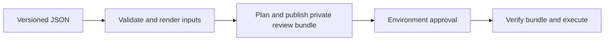

# Maintenance and recovery

Daily operators use the JSON and the Apply/Destroy workflows. Start with
[customer setup](customer-setup.md), the [configuration reference](configuration-reference.md)
and the [walkthrough](demo-guide.md). This guide is for maintaining the automation.

## Execution path



Creation runs subscription → databases → Agent Memory; deletion reverses that
order. Each resource has its own state, so Python coordinates dependencies across
states. Terraform controls resources and dependencies inside each stack.

| Start here | Responsibility |
| --- | --- |
| `scripts/rediscloud_config.py` | CLI for JSON validation and input rendering |
| `scripts/rediscloud_review.py` | CLI for review preparation, bundle loading and execution |
| `scripts/rediscloud_auth_check.py` | Administrative API access check before planning |
| `scripts/rediscloud/config.py`, `schema.py`, `config_common.py` | Configuration loading, schema checks and private JSON writing |
| `subscription.py`, `database.py`, `agent_memory.py` in that package | Resource-specific validation and input mapping |
| `stacks.py` | State identities, recognized resources and dependency order |
| `lifecycle.py` | Planning and approved execution, including deferred steps |
| `inventory.py`, `agent_memory_state.py` | Omitted-resource discovery and deletion-only inputs reconstructed from state |
| `bundles.py`, `terraform.py` | Review bindings, saved plans, provider/lock checks and Terraform CLI calls |
| `reporting.py` | Summaries that omit secret values |

For a new field, start in its resource module. For an ordering issue, start in
`lifecycle.py`; for state omission/recovery, start in `inventory.py`. The package
modules are implementation units, not additional commands operators must run.

## State and approval invariants

State keys are durable:

```text
subscriptions/<subscription_key>/subscription.tfstate
subscriptions/<subscription_key>/databases/<database_key>.tfstate
subscriptions/<subscription_key>/agent-memory/<store_key>.tfstate
```

Renaming keys, adopting console-created resources or transferring ownership needs
explicit state reconciliation. No automatic import is performed. Omitted managed
entries produce deletion plans; unfamiliar or ambiguous state stops reconciliation.
Retained agents must not still reference a database proposed for omission.

Existing dependencies are planned before approval. New/replaced/renamed parents
can defer dependent plans. Their input files are frozen before approval; the
actual plans are generated after those parents exist. A preview cannot prove the
complete first-deployment lifecycle.

The review binds commit, run/attempt, Terraform version, provider binary, stack
locks, backend and approval environment. All saved payloads are checked before
the first apply. Plans expire after one hour. Only explicitly deferred plans are
generated after approval. Removed stores are destroyed before removed databases,
then configured resources are applied in creation order.

Apply and destroy share a repository concurrency group. S3 locks coordinate each
state. Completed changes are not rolled back when a later step fails.

## Reading the Terraform

| Pattern | Why it appears |
| --- | --- |
| `object`, `list(object)`, `map(object)` | One structured input, repeated nested items, or named resource instances |
| `optional(...)`, `null`, `[]` | Distinguish omitted values/blocks from an empty collection; defaults belong to input/provider contracts |
| `dynamic` with `[]` or `[object]` | Emit zero or one provider blocks from an optional object |
| Resource `for_each` over a map | Keep addresses stable when siblings are added; removing a key removes that resource |
| Lookup `count` and guarded `[0]` | Resolve existing parents only when a direct ID was not supplied |
| `validation` | Check an individual input |
| `terraform_data` with `lifecycle.precondition` | Hold cross-input/dependency checks in state without creating a Redis resource |
| `depends_on` and attribute references | Order resources inside one state; workflow orchestration handles other states |
| `can(regex(...))` | Turn a name mismatch into the intended validation message |
| `try`, `coalesce` | Handle absent nested values and select supported defaults |

Name normalization lowercases, replaces runs matching `[^a-z0-9]+` with `-`,
collapses repeated hyphens and trims their ends. The anchored validation
`^[a-z0-9][a-z0-9-]{1,61}[a-z0-9]$` requires a complete 3–63 character name with
alphanumeric ends. Backslashes in quoted HCL/JSON strings must be escaped;
`[0-9]` avoids that extra escape for an ASCII digit match.

The stacks' lifecycle preconditions do not prevent destruction or suppress drift.
The provider decides update versus replacement. Review immutable changes and
application migration before applying. Direct parent IDs skip their data-source
checks, so verify external database prerequisites separately.

Backend `create_bucket` is a stable ownership choice. Do not toggle it to detect
existence. `force_destroy = false` blocks non-empty bucket deletion through S3;
it is not a general `prevent_destroy` rule. Keep bootstrap state backed up.

## Failures and recovery

Keep the JSON and inspect the failed step. Resolve the service/configuration
issue, then generate a new review from the same state keys. Start a new run or
rerun all jobs: an apply-only retry cannot reuse a bundle from another attempt.

| Situation | Operator action |
| --- | --- |
| API rejection or failed task | Keep the task ID and error; correct the cause before reviewing a retry |
| Create acknowledged but readiness failed | The ID can be saved and the resource tainted; inspect the remote store and replacement proposal before approving |
| Remote create succeeded but no identity was saved | Identify/import the exact resource before retrying to avoid duplicates |
| Stale lock | Confirm no operation is active; an authorized operator may unlock the exact state by its lock ID |
| Unrecognized omitted state | Back up the state version and reconcile ownership/shape manually |
| Selective destroy followed by recreation | Remove its JSON entry too if it should remain deleted |

Restoring a state version restores Terraform's record, not application data or
infrastructure. Confirm resource identities and that no later apply has progressed.

A replacement receives a new store ID and keys. Application context is not
automatically migrated. Loss of access through the old ID does not prove physical
data erasure; confirm retention and cleanup requirements with the service team.
This project does not perform an implicit flush or delete internal Redis key patterns.

## Credentials and access

Sensitive outputs suppress ordinary display; they do not encrypt state. State,
rendered inputs and plan bundles require private storage and restricted access.
Model credentials are write-only in provider state, but renderer root inputs are
not ephemeral. Increase `api_key_version` when changing a model secret.

Rotate runtime keys by creating a second named key, delivering/testing it, then
removing the old key. Setting its JSON `enabled` flag false revokes it on apply.
`secret_ref` is metadata and performs no secret publication.

OIDC trust needs the allowed plan branch and the selected deployment environment.
The default S3-managed encryption path is qualified; custom KMS policies and
permissions need their own setup. Removing current plan objects does not remove
their older S3 versions; define retention separately.

## Tests and upgrades

Use the Python environment from setup:

```bash
python -m unittest discover -s tests -v
terraform fmt -check -recursive
```

The maintained suite covers schema/input mapping, ownership, dependency order,
saved/deferred plans, no-op, omission, selective/full destroy, failed
execution, private summaries and rejected tampered/expired bundles. The simulated commands in `tests/fakes/` and synthetic state keep these tests
independent of customer resources.

The Terraform stack contract test needs `MOCK_PROVIDER_BINARY` pointing to the
candidate binary and optionally `TF_ACC_TERRAFORM_PATH` pointing to Terraform.
It uses fake credentials and no refresh to verify the current block/state shape
can produce a deletion-only plan. Without the binary, that test reports a skip.

**Terraform Validate** checks configuration/tests, all four stacks, and four
mocked AWS bootstrap tests. In branch mode it builds the pinned provider and runs
the stack contract test. There is no live provider-development workflow in this
customer repository.

For a provider upgrade, use a branch, update the workflow source pins or Registry
lock selections, run these checks, then rehearse create, unchanged reapply,
update, addition, selective removal and teardown on isolated target-account
resources. Exercise replacement separately with known disposable context.

For new fields, update the JSON Schema, renderer, Terraform variables/resource,
documentation and relevant regression together. Breaking JSON changes require a
schema-version migration; provider state upgrades are a separate concern.

Git records desired configuration and code history, Actions records runs, and
Terraform state records managed identities. Scheduled account-wide inventory,
drift detection and automatic adoption are outside this reference.
